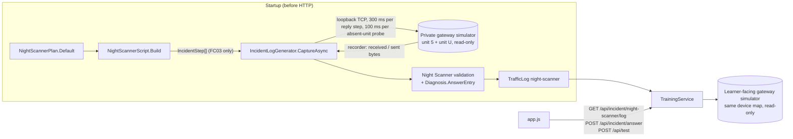

# Design Document: night-scanner

## Overview

The Night Scanner is the second `security` case. It reuses the Phantom Writer pipeline end to end:

| Phantom Writer piece | Reused as | Generalisation needed |
|---|---|---|
| `ModbusSimulator(unit, registers, allowWrites, recorder)` | Private and learner-facing gateway simulators | New constructor that takes a map of unit ID → register maps. The old constructor delegates to it. Unknown unit IDs stay silent, as today. |
| `IncidentStep` | Every HMI poll and scan request | Optional `Unit` parameter, default `IncidentScript.Unit` (5), so the Phantom Writer script is unchanged. |
| `IncidentLogGenerator.GenerateAsync` | Unchanged entry point for Phantom Writer | The connection, recording and decoding loop moves into a shared `CaptureAsync` that also records `timeout` and `exception` entries. Each case keeps its own validation. |
| `TrafficLogEntry` | Same entry shape | Additive `exception_code` (int or null). `status` can now be `timeout` or `exception`. |
| `TrainingService.IncidentLog(id)` and `GET /api/incident/{id}/log` | Same route | Logs stored in a dictionary keyed by the fixed security case IDs. |
| `Diagnosis.ForAnswer` and `POST /api/incident/answer` | Same route and request shape | Dispatches on `log.scenario_id`. New `Diagnosis.AnswerEntry(log)` gives the correct entry per case. Every unverified answer returns one identical reply without a log entry. Mitigations chosen per case. |
| Frontend log table, answer form, progressive hints, row flag | Same components | New Status column. Task text, hints and flag label come from the scenario's `incident` field instead of Phantom Writer constants. |

Device choice: the gateway routes **the same boiler controller at unit 5** as Phantom Writer, here with its normal setpoint 650 (a different simulated night, no write). Reusing the device keeps the documentation familiar and lets the initial read look normal, which is the point of the case: the process value is fine and the evidence is in the network capture.

Design choices that resolve tensions in the brief:

| Tension | Decision | Reason |
|---|---|---|
| "Same bounded timeout as elsewhere" vs. "make timeouts in the generator short" | Steps expected to get a reply (HMI polls of unit 5, the scan request to unit 5 that returns exception 02, and the scan request to the responding unit) use the 300 ms Modbus deadline. Only scan probes of unit IDs with no device use a 100 ms deadline. Both use the same cancellation-token mechanism. Learner reads keep 300 ms. The capture note states the 100 ms value. (Revised after the session 10 security review; it first used 100 ms for every step, so a slow host could fail startup.) | With the default plan, 8 sweep requests get no reply. At 300 ms that adds 2.4 s to every start and to every property case; at 100 ms it adds 0.8 s. A step that should get a reply gets the full Modbus deadline, so a slow Windows/WSL host does not fail startup. |
| A timeout must be real, not scripted | An entry is `timeout` only when the generator's deadline expired **and** the simulator recorder reports `Sent == null` for that connection. Any disagreement fails startup. | The log status is evidence from both ends of the exchange, not a constant. |
| "Exactly one correct answer" must not come from script constants | `Diagnosis.AnswerEntry` derives the scanning client from the log (the only client addressing ≥ 3 distinct unit IDs) and takes its first entry. The generator checks that this equals the plan. | The verified rule depends only on evidence, like Phantom Writer's "values read from log entries". |
| A property "for any seed" vs. a deterministic production log | `NightScannerPlan.Default` is fixed. `NightScannerPlan.FromSeed(seed)` derives a plan for tests from a SplitMix64 sequence. Both go through the same generator and validation. | Production stays deterministic (Req. 2.8); the property covers many plans. |
| Hints are case-specific | Hints, task text and the flag label move to an additive `incident` object in `GET /api/scenarios`. | Avoids hard-coding scenario IDs in `app.js` and keeps Phantom Writer's text unchanged. |
| Answer redaction could hint at the answer | ~~Keep Phantom Writer's rule: redact `log_entry.client` only when the submitted transaction is the answer entry.~~ Revised after the session 10 security review: the redaction and the "client label differs" wording marked the answer row (an answer oracle against Req. 3.6). Every unverified answer in both security cases now gets one identical reply with `log_entry: null`; only the echoed `answer` differs. Progressive hints stay client-side and generic. | The reply must not depend on which part of the pair was wrong. The harness checks this byte for byte for every log entry of both cases. |
| A step deadline can expire during connect or write | `CaptureAsync` catches step-deadline cancellation around connect and write and rethrows `InvalidOperationException` naming the step and its deadline. The "5 s startup deadline" message is kept only for cancellation of the outer token. | The startup error names the real cause. |

Out of scope: writes of any kind in the Night Scanner, Modbus gateway exception codes 0A/0B (the simulator stays silent, as documented in `modbus-protocol.md`), multiple scans per capture, sub-second timestamps.

## Architecture



Startup: the `TrainingService` constructor creates the troubleshooting simulators, generates the Phantom Writer log, then the Night Scanner log, all under one 5 s deadline, then creates the learner-facing `night-scanner` gateway simulator. The private gateway is disposed when `GenerateNightScannerAsync` returns. `GhostWireHost.Create` already resolves `TrainingService` eagerly, so a failure stops startup.

## Components and Interfaces

### `ModbusSimulator` (changed, `Modbus.cs`)

```csharp
public ModbusSimulator(int unit, Dictionary<int, Dictionary<int, ushort>> registers, bool allowWrites = false, IExchangeRecorder? recorder = null)
    : this(new Dictionary<int, Dictionary<int, Dictionary<int, ushort>>> { [unit] = registers }, allowWrites, recorder) { }
public ModbusSimulator(Dictionary<int, Dictionary<int, Dictionary<int, ushort>>> devices, bool allowWrites = false, IExchangeRecorder? recorder = null);
```

`ServeAsync` looks up `devices[header[6]]`. A missing unit is recorded with `Sent = null` and kept silent, exactly as the single-unit mismatch today. All other request handling is unchanged.

### `IncidentStep`, `TrafficLogEntry` (changed, `Incident.cs`)

```csharp
public sealed record IncidentStep(string Client, ushort TransactionId, int OffsetSeconds, byte Function, ushort Address, ushort QuantityOrValue, byte Unit = IncidentScript.Unit);
public sealed record TrafficLogEntry(..., string status, IReadOnlyList<DecodedFrame> frames, int? exception_code = null);
```

### `IncidentLogGenerator.CaptureAsync` (extracted)

```csharp
private static async Task<List<TrafficLogEntry>> CaptureAsync(ModbusSimulator simulator, Recorder recorder, IReadOnlyList<IncidentStep> script,
                                                              DateTimeOffset start, TimeSpan stepDeadline, CancellationToken ct);
```

Per step, strictly in order: open a new `TcpClient` to `IPAddress.Loopback` and the simulator's port, remember the local port, write the encoded request, then read the 7-byte header and PDU and wait for end of stream under `stepDeadline`. If that deadline expires (and `ct` has not), the step's client observation is `timeout`. Connect and write are also under the deadline but are not caught: a failure there is a startup error.

After all steps, wait (bounded by `ct`, at most 1 s) until the recorder holds one exchange per step, then match exchanges to steps by remote port **and** transaction ID (script transaction IDs must be unique). Port alone is not enough: property P-f found that Windows can reuse a client port within one capture when 8 captures run at once (seed 987654321, case 25). For each step:

- Recorder `Sent == null` and client observed `timeout` → `status: "timeout"`, frames `[request]`, `values: []`.
- Recorder `Sent != null` and client observed a reply → decode the response. `fc & 0x80` → `status: "exception"`, `exception_code`, `values: []`. Otherwise `status: "response"`, values from the decoded registers (FC06: the echoed value).
- Any other combination, a request that does not decode, or a transaction ID, unit ID or function mismatch with the step → `InvalidOperationException`.

`unit_id`, `function_code`, `address` and `values` come from the decoded captured bytes. Phantom Writer calls `CaptureAsync` with its private write-enabled simulator and a 300 ms step deadline, then runs its existing validation (all 12 `response`, 650 → 950, FC06 echo where request and response hex are equal).

### `NightScannerPlan` and `NightScannerScript` (new, `Incident.cs`)

```csharp
public sealed record NightScannerPlan(int ScanUnits, byte RespondingUnit, ushort RespondingValue, int ScanStartSeconds, ushort ScanFirstTransactionId, string ScannerClient)
{
    public static readonly NightScannerPlan Default = new(10, 9, 1, 7, 301, "ENG-WS-13");
    public static NightScannerPlan FromSeed(ulong seed);   // tests only
}
public static class NightScannerScript
{
    public const string ScenarioId = "night-scanner";
    public const byte BoilerUnit = 5; public const ushort Register = 100; public const ushort Setpoint = 650;
    public const string PollClient = "HMI-01"; public const ushort ScanAddress = 0;
    public static readonly TimeSpan ProbeDeadline = TimeSpan.FromMilliseconds(100);
    public static readonly DateTimeOffset Start = new(2026, 11, 1, 3, 12, 0, TimeSpan.Zero);
    public static IncidentStep[] Build(NightScannerPlan plan);
    public static Dictionary<int, Dictionary<int, Dictionary<int, ushort>>> Devices(NightScannerPlan plan);
}
```

Plan constraints (checked by a `Validate` method that throws): 5 ≤ `ScanUnits` ≤ 12; 1 ≤ `RespondingUnit` ≤ `ScanUnits` and ≠ 5; 1 ≤ `ScanStartSeconds` ≤ 30; first scan transaction ID ≥ 100 and the scan range stays ≤ 65535; client label matches `[A-Za-z0-9._-]{1,32}` and differs from `HMI-01`.

`FromSeed`: SplitMix64 over the seed picks `ScanUnits` 5–12, `RespondingUnit` from 1–N without 5, `RespondingValue` 0–65535, `ScanStartSeconds` 1–14, first transaction ID 100–60000, and the label from {`ENG-WS-13`, `VENDOR-RDP-2`, `QA.LAPTOP_9`}.

`Build`: HMI polls at 0, 5, 10, … simulated seconds, transaction IDs 1, 2, 3, …, until the poll after the last scan request. Scan request k (k = 0 … N−1) at `ScanStartSeconds + k`, unit k+1, transaction `ScanFirstTransactionId + k`. Merged by time, HMI first on ties. All steps are FC03, quantity 1.

Default plan, as inputs (the log values are whatever the simulator returns): scan of units 1–10 at 03:12:07–03:12:16 by `ENG-WS-13`, transactions 301–310; HMI polls at 03:12:00, :05, :10, :15, :20, transactions 1–5; 15 entries in total.

`Devices(plan)`: `{ 5: { 3: { 100: 650 } }, U: { 3: { 0: RespondingValue } } }`.

### `IncidentLogGenerator.GenerateNightScannerAsync` (new)

```csharp
public static Task<TrafficLog> GenerateNightScannerAsync(NightScannerPlan plan, CancellationToken ct);
```

1. Validate the plan; build the script.
2. Create a private, read-only gateway simulator with `Devices(plan)` and a recorder. It is never stored outside this method.
3. `CaptureAsync(..., NightScannerScript.ProbeDeadline, ct)`, then dispose the simulator.
4. Validate: HMI entries are `response` with `[650]` from unit 5 at register 100; scan entry for unit u is `response` with `[RespondingValue]` if u = U, `exception` with code 2 if u = 5, `timeout` otherwise; every entry is FC03; `Diagnosis.AnswerEntry(log)` is the plan's first scan transaction and client. Any mismatch throws.

### `Diagnosis` (changed, `Training.cs`)

```csharp
public static TrafficLogEntry? AnswerEntry(TrafficLog log);   // PW: the single FC06 entry. NS: first entry of the scanning client.
public static DiagnosisResult ForAnswer(TrafficLog log, AnswerRequest answer);   // dispatches on log.scenario_id
```

Scanning client rule: group entries by client label; exactly one label must address ≥ 3 distinct unit IDs, otherwise there is no answer entry and nothing verifies.

Night Scanner answer results (observations quote the log, never constants):

- Every unverified answer, in both security cases and whichever part is wrong (unknown transaction, another entry, or the answer entry with a wrong client): the same reply. Observation "The submitted pair does not match the event this case asks for." One case-level possible cause and next step that do not depend on the submission, no training hint, no mitigations, and `log_entry: null`. Only the echoed `answer` differs.
- Verified: observations list the client and request count, unit IDs from first to last in increasing order, first and last transaction and time, shortest and longest interval in seconds, counts of timeouts / exceptions (with codes) / responses, the unit that responded, and the unit IDs addressed by every other client. Training hint: in this simulation, a run of reads to increasing unit IDs from one client, mostly unanswered, is a reconnaissance pattern, not normal polling. Next step: compare the responding unit with the simulated device documentation, which lists only unit 5.

`ForRead` keeps all current text. For `night-scanner` the second training hint is: "Training hint: a verified read confirms that unit 5 answers normally in this simulation, not which other clients queried the gateway. Open the simulated traffic log." A third hint reads: "Training hint: probing many unit IDs yourself with test reads is exactly the behavior this case teaches you to detect in the simulated traffic log."

### `TrainingService` (changed)

- `Cases` gains `night-scanner` (unit 5, FC03, address 100, value 650, scale 0.1, `°C`, `security`, `intermediate`).
- `incidentLogs: Dictionary<string, TrafficLog>`; `IncidentLog(id)` looks up only these fixed keys.
- `Scenarios()` adds `incident` = `{ task, hints[], flag }` for security cases, null otherwise.
- `AnswerAsync` uses `incidentLogs[answer.scenario_id]`, `Diagnosis.AnswerEntry` (through `Diagnosis.ForAnswer`) to decide verification, `log_entry` only when verified, and `MitigationsFor(id)`.

### Frontend

- Log table: new "Status" column after Function: `Response`, `Timeout (no reply)`, or `Exception ` + the response frame's decoded "Exception code" value (for example `Exception 02 · Illegal Data Address`). Text only, no color dependence. Value(s) shows "None" when empty. Frames row `colSpan` 10.
- The PW-specific sentence above the log becomes general definitions plus `scenario.incident.task`.
- `answerHints` and the flag text come from `scenario.incident`. Thresholds unchanged (hint 1 from the 3rd unverified answer, hint 2 from the 4th).
- Verified status message uses the flag label: 'The matching log row is now marked "<flag>".'

## Data Models

`GET /api/scenarios` entry (additive `incident`):

```json
{ "id": "night-scanner", "title": "The Night Scanner", "category": "security", "difficulty": "intermediate",
  "initial": { "unit_id": 5, "function_code": 3, "address": 100, "quantity": 1, "scale": 0.1 },
  "incident": { "task": "…", "hints": ["Look at the Unit ID column: does any client ask many different units?", "Find the first request in that run."], "flag": "⚠ First scan request" } }
```

Log entry for a timeout (shape; values come from the run):

```json
{ "sequence": 3, "time": "2026-11-01T03:12:07Z", "client": "ENG-WS-13", "transaction_id": 301, "unit_id": 1, "function_code": 3,
  "function_name": "Read Holding Registers", "address": 0, "values": [], "status": "timeout", "frames": [ { "direction": "request", … } ], "exception_code": null }
```

## Error Handling

| Condition | Behavior |
|---|---|
| Plan outside its constraints | `ArgumentException` from `NightScannerPlan.Validate`; at startup this stops the server. |
| Expected reply missing, unexpected reply, or client and recorder disagree | `InvalidOperationException`; startup stops. No partial log is served. |
| Both generators exceed 5 s together | `InvalidOperationException` "Incident traffic log generation exceeded its 5 s startup deadline". |
| `GET /api/incident/{other}/log` | 404, unchanged. |
| Answer validation | Unchanged; `night-scanner` is accepted because it is a `security` case. |

## Testing Strategy

Example checks (harness):

- `/api/scenarios`: five entries; `night-scanner` is `security` / `intermediate`; `incident.hints` match the brief; troubleshooting entries have `incident: null`.
- `/api/test` night-scanner initial read: `response`, raw 650, 65.0 °C, verified, hint mentions the traffic log. A read of unit 1 times out and a read of unit 9 returns a response on the learner-facing gateway.
- Raw FC06 to the learner-facing gateway returns `86 01`; register 100 still reads 650.
- Default log: 15 entries; 5 from `HMI-01` (all response 650, unit 5); 10 from `ENG-WS-13` with unit IDs 1–10, transactions 301–310; 8 timeouts with one request frame each, unit 5 exception 02, unit 9 response; every frame re-decodes to its entry; identical JSON across two `TrainingService` instances; no FC06 entries.
- Answers: `301` / `ENG-WS-13` verifies with four mitigations and observations citing the label, `1 to 10`, 301, 310, `8 timeout`, unit 9. Wrong variants: (302, `ENG-WS-13`), (301, `HMI-01`), (1, `HMI-01`), (4242, `X`) → not verified, no mitigations; the last three bodies do not contain `ENG-WS-13`.
- Phantom Writer checks unchanged (log of 12 entries, now with `exception_code: null`).

Property P-f **Night Scanner capture** (seeded, printed base seed, per-property seed as in the harness): 48 cases in batches of 8. For each case, `plan = NightScannerPlan.FromSeed(rng.Next())`, `log = await GenerateNightScannerAsync(plan, 5 s)`. Assert: scanning client's unit IDs strictly increase and equal 1…N; exactly one scan entry is `response` and it is unit U; unit 5's scan entry is `exception` 02; all other scan entries are `timeout` with exactly one frame; transaction IDs are unique; and over all pairs (transaction ID from the log × client label from the log, plus each transaction with a lower-cased label) exactly one pair verifies through `Diagnosis.ForAnswer`, and it is (first scan transaction, scanner label). Expected runtime: about 1 s per batch.

Browser check (temporary script outside the repository, deleted afterwards): case listed under "Security incidents"; log shows the scan with Status text; three wrong answers show hint 1; the correct answer verifies and flags the row; no console errors; no horizontal overflow at 360 px.

## Safety Review Checklist

- No new input selects a host, port or URL. `night-scanner` is a fixed dictionary key.
- The Night Scanner generator encodes only FC03 (`ModbusCodec.EncodeReadRequest` throws for anything else).
- Both gateway simulators bind loopback, use `allowWrites: false` and answer FC06 with exception 01.
- The private gateway is disposed before the server serves HTTP.
- Every status, value and frame in the log is decoded from captured bytes and cross-checked with the recorder.
- Mitigations are labeled real-world guidance not verified by this simulation.
