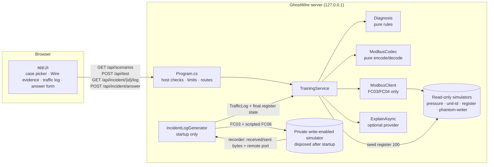

# Design Document: ot-security-lab

## Overview

The feature adds four things to the existing ASP.NET Core minimal API and plain JavaScript frontend:

1. A pure **Modbus codec** (`ModbusCodec`) that encodes and decodes FC03, FC04 and FC06 ADUs into labeled fields. It never throws on input bytes.
2. **Wire capture** on both sides of each loopback exchange. `ModbusClient` returns the bytes it actually wrote and read. `ModbusSimulator` can report the bytes it received and sent to an optional recorder.
3. The **Phantom Writer** incident case. At startup an `IncidentLogGenerator` runs a fixed script of 12 exchanges against a private, write-enabled simulator, records them through the simulator's recorder, checks them against the script, and disposes that simulator. Learners then read a separate read-only simulator seeded from the captured final state, browse the captured log and submit an answer.
4. **Category and difficulty** on each scenario, a grouped case picker, and property-based tests in the existing harness.

Design choices that resolve tensions in the brief:

| Tension | Decision | Reason |
|---|---|---|
| "Generated from real loopback exchanges" vs. "learner-reachable simulators reject FC06" | Two simulators. The generator's private simulator has `allowWrites: true` and lives only during startup. The learner-facing `phantom-writer` simulator is read-only and seeded from the captured final value. | The existing raw TCP check "writes must be rejected" stays true for every simulator a request can reach. |
| Modbus TCP has no client identity field | `client` is a label the generator assigns to each of its own TCP connections. The simulator recorder reports the remote port of each exchange, and the generator maps that port to the label of the connection it opened. | The label is tied to a real connection, and the UI states that the frame itself carries no identity. This is a teaching point: Modbus TCP cannot authenticate the writer. |
| Accessibility steering asks to mark the suspicious row; marking it early gives away the answer | No row is marked before a verified answer. After verification, the offending row shows "Unauthorized write" with an icon. | Keeps the exercise meaningful and still satisfies the steering rule once the evidence is established. |
| Product rule allows five statement labels; the brief asks for "mitigations as guidance" | `mitigations` is a separate field. The UI renders it under "Next steps · real-world guidance, not verified by this simulation". | Keeps the structured fields machine-separable while staying within the "next step" label. |
| `frames[].fields[].bytes` shape | `{ "offset": int, "length": int }` into the frame. | Needed for byte-to-field highlighting. The hex of a field can be derived from `hex` and the range. |

Out of scope: transaction ID randomization on the learner path (the client keeps transaction ID 1), new learner-selectable function codes, persistence of the log to disk, any NuGet package.

## Architecture



Startup sequence:

1. `GhostWireHost.Create` registers `TrainingService` as a singleton and resolves it immediately after `builder.Build()`, so a generator failure stops startup instead of failing on the first request.
2. The `TrainingService` constructor creates the three existing simulators, then runs `IncidentLogGenerator.GenerateAsync` synchronously with an overall 5 s deadline. Each exchange keeps the 300 ms Modbus deadline.
3. The generator validates the captured log against the script, disposes the private simulator and returns `TrafficLog` and the captured final value of register 100.
4. `TrainingService` creates the read-only `phantom-writer` simulator with register 100 set to that captured value.

Request flow for `POST /api/test` is unchanged except that `ModbusClient.ReadAsync` returns the exchanged bytes, `TrainingService` decodes them into `frames`, and diagnosis text comes from the pure `Diagnosis` class.

## Components and Interfaces

### `ModbusCodec` (new, `Modbus.cs`)

Pure static class, no I/O. All multi-byte fields big-endian through `BinaryPrimitives`.

```csharp
public enum FrameDirection { Request, Response }
public sealed record ByteRange(int offset, int length);
public sealed record FrameField(string name, string value, ByteRange bytes);
public sealed record DecodedFrame(string direction, string hex, IReadOnlyList<FrameField> fields, string? decode_error);

public sealed record Mbap(ushort TransactionId, ushort ProtocolId, ushort Length, byte UnitId);
public sealed record ParsedAdu(Mbap Header, byte Function, ushort? Address, ushort? QuantityOrValue,
                               byte? ByteCount, ushort[] Registers, byte? ExceptionCode);

public static class ModbusCodec
{
    public static byte[] EncodeReadRequest(ushort tx, byte unit, byte function, ushort address, ushort quantity); // fc 3|4
    public static byte[] EncodeWriteSingleRequest(ushort tx, byte unit, ushort address, ushort value);         // fc 6
    public static byte[] EncodeReadResponse(ushort tx, byte unit, byte function, ReadOnlySpan<ushort> registers);
    public static byte[] EncodeWriteSingleResponse(ushort tx, byte unit, ushort address, ushort value);        // echo
    public static byte[] EncodeException(ushort tx, byte unit, byte function, byte code);                      // fc | 0x80

    public static DecodedFrame Decode(ReadOnlySpan<byte> adu, FrameDirection direction);   // never throws
    public static bool TryParse(ReadOnlySpan<byte> adu, FrameDirection direction, out ParsedAdu? parsed, out string? error);
    public static string Hex(ReadOnlySpan<byte> bytes);   // "00 01 00 00 00 06 07 03 00 0A 00 01"
}
```

Encoders validate their arguments (function, quantity 1–125, `address + quantity <= 65536`, register count 1–125) and throw `ArgumentOutOfRangeException` on invalid arguments. Encoders take trusted values from server code. Learner input reaches them only after `TrainingService.Validate`.

`Decode` walks the bytes in order and appends a field for each complete field it can read. It stops at the first failure and sets `decode_error`. Checks, in order:

1. At least 7 bytes for the MBAP header.
2. Protocol ID is `0x0000`.
3. Length is 2–254 and equals `adu.Length - 6`.
4. Function code present. If `fc & 0x80`, exactly one exception code byte follows.
5. For FC03/FC04: a request has exactly 4 data bytes, and the quantity must be 1–125. A response has byte count = `adu.Length - 9`, and the byte count must be even and 2–250.
6. For FC06: exactly 4 data bytes (address, value), in both directions.
7. Any other function code: decoded as "Function code (unsupported in this simulation)" with `decode_error` set.

Field names and value format (value is always a string):

| Field | Example value |
|---|---|
| Transaction ID | `1 (0x0001)` |
| Protocol ID | `0 (0x0000) · Modbus` |
| Length | `6 bytes follow` |
| Unit ID | `7` |
| Function code | `03 · Read Holding Registers`, `86 · Exception for 06` |
| Start address / Register address | `10 (0x000A) · zero-based offset` |
| Quantity | `1 register(s)` |
| Byte count | `2` |
| Register 10 | `39 (0x0027)` (named by absolute offset when the request is known, else `Register 1`, `Register 2`, …) |
| Register value (FC06) | `950 (0x03B6)` |
| Exception code | `02 · Illegal Data Address` |

`Decode` has an overload `Decode(adu, direction, int? requestAddress)` so response register fields can be named by absolute offset.

### `ModbusClient` (changed)

```csharp
public sealed record ModbusExchange(byte[]? Sent, byte[]? Received);
public sealed record ModbusResult(string Status, ushort[] Values, int? ExceptionCode, ModbusExchange Exchange);

public static Task<ModbusResult> ReadAsync(int port, int unit, int function, int address, int quantity, CancellationToken ct);
```

- Throws `ArgumentOutOfRangeException` before opening a socket if `function` is not 3 or 4. This is the guard for Requirement 5.3.
- Builds the request with `ModbusCodec.EncodeReadRequest(1, …)`.
- Sets `Sent` only after `WriteAsync` completes. Accumulates `Received` as header and PDU bytes are read: the 7-byte header, then the PDU if it was read. On timeout after sending, `Received` is null (no partial bytes are presented as a frame).
- Status rules are unchanged. The existing positional constructor use in `TrainingService` is updated; `ModbusResult` has no external consumers.

### `ModbusSimulator` (changed)

```csharp
public sealed record SimulatorExchange(int RemotePort, byte[] Received, byte[]? Sent);
public interface IExchangeRecorder { void Record(SimulatorExchange exchange); }

public ModbusSimulator(int unit, Dictionary<int, Dictionary<int, ushort>> registers,
                       bool allowWrites = false, IExchangeRecorder? recorder = null);
```

- `Received` is the 7-byte header plus PDU read from the socket. `Sent` is the reply header plus PDU, or null when the simulator stays silent (unit mismatch).
- With `allowWrites: false` (default), FC06 returns exception 01, as today.
- With `allowWrites: true`, FC06 with a 5-byte PDU writes the holding register (function 3 map) if the address exists and replies with an echo of the request PDU. A missing address gets exception 02. Register access is guarded by a lock.
- Binding stays `IPAddress.Loopback`, port 0.
- The recorder is called once per handled request, after the reply is written, and is never called with learner-supplied data outside the harness. The recorder must not throw; the simulator catches and ignores recorder exceptions so recording cannot affect protocol behavior.

### `IncidentLogGenerator` (new, `Incident.cs`)

Internal startup component. It is the only code that encodes and sends FC06.

```csharp
public sealed record IncidentStep(string Client, ushort TransactionId, int OffsetSeconds, byte Function, ushort Address, ushort QuantityOrValue);
public static class IncidentScript { public static readonly IncidentStep[] PhantomWriter; public const ushort InitialSetpoint = 650; }
public static class IncidentLogGenerator
{
    public static Task<(TrafficLog Log, ushort FinalSetpoint)> GenerateAsync(CancellationToken ct);
}
```

Script (constants in code; these are inputs to the simulator, not claimed results):

| Seq | Simulated time (UTC) | Client label | Transaction ID | Function | Address | Quantity / value |
|---|---|---|---|---|---|---|
| 1–7 | 2026-10-31T02:13:00Z + 5 s steps (00, 05, …, 30) | `HMI-01` | 1–7 | 03 | 100 | 1 |
| 8 | 2026-10-31T02:13:33Z | `MAINT-LAPTOP-07` | 1111 (0x0457) | 06 | 100 | 950 |
| 9–12 | 02:13:35Z, 02:13:40Z, 02:13:45Z, 02:13:50Z | `HMI-01` | 8–11 | 03 | 100 | 1 |

Procedure:

1. Create a private `ModbusSimulator(unit: 5, { [3] = { [100] = 650 } }, allowWrites: true, recorder)`. Its port is never stored in `TrainingService` or exposed.
2. For each step in order, open a new `TcpClient` to `IPAddress.Loopback` and the private port, record `local port → step's client label`, send the encoded ADU, and read the reply with a 300 ms deadline. The simulator serves one request per connection today, so one connection per step avoids changing its connection handling.
3. Steps run strictly one after another, so the order of recorder entries matches the script order.
4. After all steps, match recorder entries to steps by remote port and transaction ID. Build each `TrafficLogEntry` by decoding `Received` and `Sent` with `ModbusCodec.Decode`.
5. Validate: 12 entries; every entry has a response; entries 1–7 return 650; entry 8 is an FC06 echo of address 100, value 950; entries 9–12 return 950. Any mismatch throws `InvalidOperationException`.
6. Dispose the private simulator. Return the log and the value read in entry 12 as `FinalSetpoint`.

Simulated timestamps come from the script, not the wall clock, so the log is identical on every start (Requirement 2.4). Remote ports differ between runs and are not included in the log.

### `Diagnosis` (new, extracted from `TrainingService.TestAsync`)

```csharp
public sealed record DiagnosisResult(List<string> Observations, string[] PossibleCauses, string[] TrainingHints, string[] NextSteps, bool Verified);
public static class Diagnosis
{
    public static DiagnosisResult ForRead(Scenario scenario, TestRequest request, ModbusResult result, double? engineeringValue);
    public static AnswerResult ForAnswer(IncidentCase incident, TrafficLog log, int transactionId, string client);
}
```

`ForRead` keeps the existing text and branching for the three troubleshooting cases, so Requirement 7.3 holds by construction. For `phantom-writer` it adds a training hint: "Training hint: a verified read confirms the current simulated setpoint, not who changed it. Open the simulated traffic log." Moving the logic into a pure function lets property (d) run without sockets.

`ForAnswer` rules:

- Find the log entry with `transaction_id`. Compare `client` using ordinal, case-insensitive matching after trimming.
- Verified only when that entry is the scripted FC06 entry and the client label matches.
- Not verified, entry exists: observation "In this simulated capture, transaction N from <label> is FC03 · Read Holding Registers at address 100." Possible cause: "The submitted pair does not match a write in this capture." No hint about the correct row.
- Not verified, entry exists and is the write but the client label is wrong: observation states that transaction N is an FC06 write and that the submitted client label differs from the capture's label for that transaction. This reveals only what the selected row already shows.
- Not verified, no entry: observation "No transaction N appears in this simulated capture."
- Verified: observations list function 06, unit 5, address 100, old value 650 (from the last read before the write), new value 950 (from the write echo and the next read), simulated time and client label, each read from the log entries rather than from constants.

### `TrainingService` (changed)

- `Scenario` gains `category`, `difficulty`, `engineeringUnit` (`"bar"`, `"°C"` or null). `requiredScale` for `phantom-writer` is 0.1.
- `Scenarios()` adds `category` and `difficulty` to each entry.
- `TestAsync` builds `frames` from `response.Exchange`, adds `frames` to the evidence before calling `ExplainAsync`, and sets `unit` from `engineeringUnit` (the `pressure-scaling` result still gets `"bar"`).
- New `IncidentLog(string scenarioId)` returns the log DTO or null.
- New `ValidateAnswer(JsonElement)` with the same exact-field approach as `Validate`.
- New `AnswerAsync(AnswerRequest, CancellationToken)` calls `Diagnosis.ForAnswer`, attaches mitigations when verified, then calls `ExplainAsync`.

The `phantom-writer` read path in `TestAsync` is the same code as the other cases: FC03/FC04 through `ModbusClient`.

### HTTP routes (`Program.cs`)

| Method and path | Handler | Limits |
|---|---|---|
| `GET /api/scenarios` | unchanged route, additive fields | global rate limit |
| `POST /api/test` | unchanged route, additive `frames` | content type, 16 KiB, 8-slot gate |
| `GET /api/incident/{scenario_id}/log` | `service.IncidentLog(id)`; 404 if null | global rate limit |
| `POST /api/incident/answer` | `ValidateAnswer` then `AnswerAsync` | content type, 16 KiB, same 8-slot gate (it can call the provider) |

The body-reading code in `/api/test` is extracted into a local helper `ReadJsonBodyAsync` and reused by `/api/incident/answer`. `{scenario_id}` is matched against the known security case IDs only. It is never used to build a path, host or URL. The catch-all `/api/{**path}` 404 stays last.

### Frontend (`index.html`, `app.js`, `styles.css`)

- **Case picker**: `<select id="scenario">` with `<optgroup label="Troubleshooting">` and `<optgroup label="Security incidents">`. Option text: `Phantom Writer · intermediate`. Native keyboard support.
- **Wire evidence**: a `<details id="wire-evidence">` (collapsed) inside `#result`, summary "Wire evidence (simulated frames)". A short intro paragraph defines MBAP header, PDU, unit ID and function code. For each frame: an `<h4>` ("Request sent to simulator" / "Response from simulator"), a `<code class="hex">` where each byte is a `<span data-i="n">`, and a `<table>` with `<th scope="col">` Field / Bytes / Value. Each body row has `tabindex="0"` and `aria-describedby` pointing to a visually hidden "bytes N–M" text. On `mouseenter` and `focusin`, the matching byte spans get `class="hl"` (underline plus background, so not color alone). `decode_error` renders as a text row "Decode error: …". With `prefers-reduced-motion: reduce`, no transitions.
- **Traffic log panel** (security cases only): a `<section aria-labelledby="log-title">` with a `<table>` of columns Seq, Simulated time, Client label, Transaction ID, Unit ID, Function, Address, Value(s), Frames. Each row has a "Select" button that fills the answer form, and a nested `<details>` that reuses the Wire evidence renderer for that entry's frames. A note states that the capture is simulated and that Modbus TCP frames carry no client identity.
- **Answer form**: `transaction_id` (number, 0–65535), `client` (text, pattern `[A-Za-z0-9._-]{1,32}`), submit. The result reuses the evidence-grid layout plus a "Next steps · real-world guidance, not verified by this simulation" list for `mitigations`. Results are announced through the existing `role="status"` message without moving focus. After a verified answer the matching log row gets `data-flag="unauthorized"`, a visible "⚠ Unauthorized write" text badge and a hatched left border.
- All new text uses `textContent`; no `innerHTML` with server data.
- Case history keeps reads and adds answer attempts for security cases; the print report includes them.

## Data Models

### `GET /api/scenarios` entry (additive)

```json
{
  "id": "phantom-writer",
  "title": "Phantom Writer",
  "summary": "A simulated boiler setpoint changed without an approved work order.",
  "initial": { "unit_id": 5, "function_code": 3, "address": 100, "quantity": 1, "scale": 0.1 },
  "documentation": [
    "Simulated boiler controller: unit 5, holding register offset 100 is the temperature setpoint.",
    "The setpoint register uses 0.1 °C per count. The documented normal value is 650 (65.0 °C).",
    "A simulated traffic capture from the controller's network segment is available for this case."
  ],
  "category": "security",
  "difficulty": "intermediate"
}
```

Existing cases: `pressure-scaling` and `unit-id` are `troubleshooting` / `beginner`; `register-addressing` is `troubleshooting` / `intermediate`.

### `POST /api/test` result (additive)

All existing fields stay. New field:

```json
"frames": [
  { "direction": "request",  "hex": "00 01 00 00 00 06 07 03 00 0A 00 01",
    "fields": [ { "name": "Transaction ID", "value": "1 (0x0001)", "bytes": { "offset": 0, "length": 2 } }, "…" ],
    "decode_error": null },
  { "direction": "response", "hex": "00 01 00 00 00 05 07 03 02 00 27", "fields": [ "…" ], "decode_error": null }
]
```

The hex above is the example from `modbus-protocol.md` for the Giant Pressure read. The harness asserts it against the actual simulator output before the docs quote it.

### Traffic log (`GET /api/incident/phantom-writer/log`)

```json
{
  "scenario_id": "phantom-writer",
  "simulated": true,
  "capture_note": "Simulated capture generated at server start from loopback exchanges with a private simulator. Modbus TCP frames carry no client identity; client labels are capture metadata.",
  "entries": [
    { "sequence": 8, "time": "2026-10-31T02:13:33Z", "client": "MAINT-LAPTOP-07",
      "transaction_id": 1111, "unit_id": 5, "function_code": 6, "function_name": "Write Single Register",
      "address": 100, "values": [950], "status": "response",
      "frames": [ { "direction": "request", "hex": "…", "fields": [ "…" ], "decode_error": null },
                  { "direction": "response", "hex": "…", "fields": [ "…" ], "decode_error": null } ] }
  ]
}
```

`address`, `values`, `unit_id` and `function_code` are taken from the decoded captured bytes, not from the script.

### Answer request and response

Request (exact fields): `{ "scenario_id": "phantom-writer", "transaction_id": 1111, "client": "MAINT-LAPTOP-07" }`

Response:

```json
{
  "status": "answered",
  "verified": true,
  "answer": { "scenario_id": "phantom-writer", "transaction_id": 1111, "client": "MAINT-LAPTOP-07" },
  "observations": [ "In this simulated capture, transaction 1111 at 2026-10-31T02:13:33Z from client label MAINT-LAPTOP-07 is function 06 (Write Single Register) to unit 5, register 100, value 950.", "…" ],
  "possible_causes": [],
  "training_hints": [ "Training hint: Modbus TCP has no built-in authentication, so any client that can reach the device can send FC06 in this simulation." ],
  "next_steps": [ "Compare the write time with approved change records." ],
  "mitigations": [
    "Real-world guidance, not verified by this simulation: segment the control network into IEC 62443 zones and conduits so only approved systems can reach the controller.",
    "Real-world guidance, not verified by this simulation: allow-list write function codes (such as FC06 and FC16) per source on a Modbus-aware gateway or industrial firewall.",
    "Real-world guidance, not verified by this simulation: where devices support it, use Modbus/TCP Security (TLS with X.509 certificates that carry roles) so writes require an authorized identity.",
    "Real-world guidance, not verified by this simulation: log setpoint changes with source and time, and review them against change records."
  ],
  "explanation": "…",
  "explanation_source": "deterministic"
}
```

Wire format note: `values` and `raw_registers` are JSON arrays of integers. `ushort[]` serializes as a number array with `System.Text.Json`, as today.

## API Contract Changes

| Endpoint | Change | Compatibility |
|---|---|---|
| `GET /api/scenarios` | Adds `category`, `difficulty`; adds the `phantom-writer` entry | Additive. Clients that index by `id` are unaffected; the scenario count rises from 3 to 4. |
| `POST /api/test` | Accepts `scenario_id: "phantom-writer"`; adds `frames`; `unit` is `"°C"` for phantom-writer | Request whitelist unchanged. Existing fields unchanged. |
| `GET /api/incident/{scenario_id}/log` | New | Returns 404 `{ "error": "Not found" }` for any id that is not a security case. |
| `POST /api/incident/answer` | New | Exact fields `scenario_id`, `transaction_id`, `client`. |

No endpoint accepts a host, port or URL.

## Error Handling

| Condition | Behavior |
|---|---|
| Learner read times out after sending | `status: "timeout"`, `frames` = [request]. Diagnosis lists at least two possible causes. |
| Loopback connect fails or the write does not complete | `status: "timeout"` or `"error"` as today; `frames` = []. |
| Response bytes malformed | `status: "error"` as today; the response frame includes decoded-so-far fields and `decode_error`. |
| `ModbusClient.ReadAsync` called with a function other than 3/4 | `ArgumentOutOfRangeException` before any socket is opened. This cannot happen from HTTP because `Validate` rejects it first. |
| Codec encoder given invalid arguments | `ArgumentOutOfRangeException`. Server bug, not learner input. |
| Codec decoder given any bytes | Returns `DecodedFrame` with `decode_error`; never throws. |
| Incident generation fails or validation mismatches | `InvalidOperationException` during `TrainingService` construction. `GhostWireHost.Create` resolves the service eagerly, so the process exits with the error at startup. No partial log is served. |
| Simulator recorder throws | Caught and ignored inside the simulator. The generator then fails validation because the entry is missing. |
| Answer body: wrong content type | 415 `{ "error": "Content-Type must be application/json" }`. |
| Answer body: missing, extra or duplicate fields; out-of-range or wrong-type values; non-security `scenario_id` | 400 `{ "error": "Expected exactly scenario_id, transaction_id and client" }` or a field-specific message. |
| Answer body over 16 KiB, empty, or invalid JSON | 400, same as `/api/test`. |
| Eight tests or answers already running | 429 `{ "error": "Too many concurrent tests" }`. |
| AI provider absent, slow, oversized or failing | Labeled deterministic explanation, as today. `verified`, `frames` and `mitigations` are already fixed before the call. |

## Testing Strategy

All tests live in the existing dependency-free harness `csharp/GhostWire.Tests/Program.cs`. A failed `Check` throws and the process exits non-zero. Tests use real loopback TCP and HTTP.

### Example-based checks (added to existing ones)

- Raw TCP: the learner-facing `phantom-writer` simulator answers FC06 with `86 01` and register 100 still reads 950 afterwards.
- `ModbusClient.ReadAsync(port, 5, 6, 100, 1, …)` throws `ArgumentOutOfRangeException`, and a recorder on that simulator sees no exchange.
- `/api/test` Giant Pressure: request frame hex equals `00 01 00 00 00 06 07 03 00 0A 00 01` and response frame hex equals `00 01 00 00 00 05 07 03 02 00 27`. Fields include `Unit ID = 7` and `Register 10 = 39 (0x0027)`.
- `/api/test` Silent Sensor initial read: `frames.length == 1`, direction `request`.
- `/api/test` Wrong Register: response frame decodes `Exception code = 02 · Illegal Data Address`.
- `/api/test` Phantom Writer read: raw 950, engineering value 95.0 (tolerance 1e-10), unit `°C`.
- `/api/scenarios`: four entries; categories and difficulties as specified; existing fields present.
- Traffic log: 12 entries, unique transaction IDs, exactly one FC06 entry, two distinct client labels, and identical JSON across two independent `TrainingService` instances (determinism).
- Traffic log: every frame's `hex` re-decodes to the entry's `unit_id`, `function_code`, `address` and `values`.
- Answer: the correct pair returns `verified: true` and four mitigations; the right transaction with the wrong client, a read transaction, and a missing transaction each return `verified: false` and empty mitigations; none of the false responses contain the string `MAINT-LAPTOP-07` unless it was submitted.
- Answer validation: extra field, duplicate field, `scenario_id: "unit-id"`, `transaction_id: 70000`, `client: "a b"`, a 33-character client and `text/plain` each return 400 or 415.
- `GET /api/incident/unit-id/log` and `GET /api/incident/../log` return 404.
- With the local test provider configured: provider text does not change `verified`, `frames` or `mitigations`, and the provider request body contains `frames`.
- All existing checks for the three troubleshooting cases keep their assertions (only the scenario count changes).

### Property-based tests

Generator: a SplitMix64 PRNG implemented in the harness (about 15 lines), so sequences do not depend on `System.Random` implementation details across .NET versions. Helpers: `NextInt(min, maxInclusive)`, `NextBytes(len)`, `Pick<T>(array)`.

Runner: `Property(string name, int cases, Func<Rng, int, Task> body)`. The base seed is a fixed constant (for example `0x6057_2026`) unless `GHOSTWIRE_PBT_SEED` is set. The runner prints `PBT seed: <seed>` once at start. Each property derives its own seed as `baseSeed ^ FNV1a(name)`, so properties can be re-run independently. Each case logs its generated input to a string. On exception the runner prints `Property '<name>' failed at case <i> with seed <seed>: <input>` and rethrows. There is no shrinking. The printed input and seed are enough to reproduce a failure.

Each property runs at least 200 cases.

| ID | Property | Generator | Assertion |
|---|---|---|---|
| P-a | **Codec round-trip.** For all valid ADUs, `TryParse(Encode(x)) == x`. | tx 0–65535; unit 0–255; for reads fc ∈ {3,4}, address 0–65535, quantity 1–min(125, 65536-address); for responses 1–125 random registers; FC06 address and value 0–65535; exceptions fc ∈ {3,4,6}, code 1–255 | Parsed header fields, function, address, quantity/value, registers and exception code equal the inputs. `Decode(...).decode_error` is null and field ranges tile the frame without gaps or overlap. `Hex` has `3·n − 1` characters. |
| P-b | **Decoder totality.** For all byte arrays, `Decode` returns and does not throw. | length 0–300 random bytes; half the cases start with a valid MBAP prefix so later checks are reached | No exception for either direction. Every field's byte range lies within the array. If `decode_error` is null, the array was a well-formed ADU (re-encoding the parse yields the same bytes). |
| P-c | **Transport status partition.** For all valid read requests against a loopback simulator, status ∈ {response, exception, timeout}, and for response `Values.Length == quantity`. | Simulator: unit 9, FC03 map with registers 0–199, FC04 map with registers 0–49. Unit = 9 with probability 0.9, else random 1–247. fc ∈ {3,4}; address 0–260; quantity 1–min(125, 65536-address). | Status in the set (never `error`); response length equals quantity; status `response` iff unit matches and the range lies in the map; `exception` has code 02. Cases run in batches of 8 concurrently to bound the time spent in roughly 20 expected 300 ms timeouts. |
| P-d | **Timeout diagnosis is never certain.** For all scenarios and requests with a timeout result, the diagnosis does not claim a single cause. | Pick any of the four scenarios; random valid `TestRequest`; synthesized `ModbusResult("timeout", [], null, exchange)` | `Verified == false`; `PossibleCauses.Length >= 2`; at least one cause does not contain "unit ID"; no observation, cause or next step matches `(?<!not |n't |never )\b(proves?|proven|confirms?|confirmed|certainly|definitely|the cause is)\b` (case-insensitive). Pure function, no sockets. |
| P-e | **Frames are the wire bytes.** For all valid read requests, `frames[0].hex == Hex(recorder.Received)` and, when present, `frames[1].hex == Hex(recorder.Sent)`. | Same simulator and generator as P-c, with an `IExchangeRecorder` that stores exchanges keyed by remote port | Request hex matches what the simulator received; response hex matches what it sent; for timeouts the recorder's `Sent` is null and there is exactly one frame. Uses the same frame-building function as `TrainingService`. |

Expected runtime: P-a, P-b and P-d take milliseconds. P-c and P-e each perform 200 loopback exchanges. With about 10% mismatched units and 8-way batches, each should take a few seconds; the harness prints the elapsed time per property.

### Manual checks

- Keyboard only: Tab into Wire evidence, open it, move through field rows and confirm the byte highlight and the "bytes N–M" text; select a log row and submit an answer; confirm the "Unauthorized write" badge is reachable.
- Screen reader spot check of the status announcements.
- `prefers-reduced-motion: reduce` in browser dev tools.
- Print report includes the incident answer attempts.

Record what was actually checked in `docs/verification.md`.

## Safety Review Checklist

- No new code path takes a host, port or URL from a request. The `scenario_id` route value is matched against a fixed list.
- The private write-enabled simulator binds loopback, is never stored where a request handler can reach it, and is disposed before the server starts accepting HTTP requests.
- `ModbusClient` cannot send FC06; `/api/test` validation still rejects function codes other than 3 and 4.
- FC06 values come from `IncidentScript` constants only.
- Every learner-facing value (log entries, frames, register values) is decoded from captured simulator bytes.
- Mitigations are labeled real-world guidance not verified by this simulation.
- The `ot-security-reviewer` agent reviews the diff against `safety.md` before the feature is considered done.
