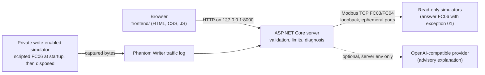

# GhostWire: OT Security & Troubleshooting Lab

GhostWire teaches technicians and students to investigate Modbus TCP faults and a security incident from evidence, using real TCP exchanges with simulated devices on their own computer.

Everything is simulated. GhostWire never connects to physical equipment or scans networks, and learners cannot send Modbus writes.

## Try it in 2 minutes

No physical hardware, AI key or third-party NuGet package is needed.

**(a) Windows release zip.** Install the [.NET 8 ASP.NET Core Runtime for Windows x64](https://dotnet.microsoft.com/download/dotnet/8.0). Download the Windows zip from [GitHub Releases](https://github.com/Wayan123/ghostwire-modbus-lab/releases), unzip it, and double-click `GhostWire.exe`. Leave its console window open and open <http://127.0.0.1:8000>. The browser does not open by itself. Keep the whole unzipped folder together, because the `.exe` alone will not run. Close the console to stop the server.

**(b) From source.** Install the [.NET 8 SDK](https://dotnet.microsoft.com/download/dotnet/8.0), then from the repository root run:

```sh
dotnet run --project csharp/GhostWire/GhostWire.csproj
```

Open <http://127.0.0.1:8000> and stop the server with Ctrl+C.

The full walkthrough is in [docs/judge-quick-start.md](docs/judge-quick-start.md).

## The four cases

| Case | Symptom (initial read) | Fix | Verified result |
|---|---|---|---|
| **The Giant Pressure** (troubleshooting, beginner) | Unit 7, FC03, address 10 returns raw 39 with scale 1 | Set scale to the documented `0.01` | `0.39 bar` |
| **The Silent Sensor** (troubleshooting, beginner) | Unit 1, FC04, address 0 times out | Set unit ID to the documented `17` | Raw 73. The timeout alone did not prove the cause |
| **The Wrong Register** (troubleshooting, intermediate) | Address 21 returns exception 02 (Illegal Data Address) | Use the documented zero-based address `20` | Raw 125 |
| **Phantom Writer** (security incident, intermediate) | Unit 5, FC03, address 100, scale 0.1 returns raw 950 (95 °C); the documented normal setpoint is 650 (65.0 °C) | In the 12-entry **Simulated traffic log**, find the one FC06 (Write Single Register) entry and submit its transaction ID and client label | Transaction `1111` from `MAINT-LAPTOP-07` at simulated time `2026-10-31T02:13:33Z` changed register 100 from 650 to 950 |

After Phantom Writer is verified, the write row is marked "⚠ Unauthorized write" and four mitigations appear under "Next steps · real-world guidance, not verified by this simulation". A wrong answer returns "not verified" without revealing the correct one.

## What makes it different

- **Wire evidence bytes.** After every read, **Wire evidence (simulated frames)** shows the actual request and response bytes in hex, with each MBAP and PDU field decoded and its byte range stated in text. The corrected Giant Pressure read sends `00 01 00 00 00 06 07 03 00 0A 00 01` and receives `00 01 00 00 00 05 07 03 02 00 27`. A timeout shows only the request frame.
- **Forensic log from real exchanges.** The Phantom Writer traffic log is decoded from the bytes a private simulator actually received and sent at startup. It is not hand-written.
- **Evidence board.** Observations, possible causes, training hints, next steps and verification are shown separately. `verified` is true only when deterministic rules confirm the expected settings and a successful simulator response. Case history keeps reads and answer attempts until page reload, and **Print case report** uses the browser's print dialog.
- **Read-only learner path.** `/api/test` accepts only FC03 and FC04 against simulator-owned loopback ports. No request field can choose a host, port or URL.

## Architecture



The server is C# on .NET 8: `Program.cs` hosts HTTP and its limits, `Modbus.cs` holds the simulator and client, and `Training.cs` holds the cases, validation, diagnosis and the optional AI explanation. See [csharp/README.md](csharp/README.md) for API limits and the local server contract.

## Built with Kiro

- How Kiro was used: [docs/kiro-usage.md](docs/kiro-usage.md)
- Spec (requirements, design, tasks): [.kiro/specs/ot-security-lab](.kiro/specs/ot-security-lab)
- Custom agents: [.kiro/agents](.kiro/agents)
- Hooks (tests after C# changes, physical-target guard, docs sync, stop check): [.kiro/hooks](.kiro/hooks)
- Session ledger: [docs/kiro-log/LEDGER.md](docs/kiro-log/LEDGER.md)

Code that existed before the contest is listed in [docs/existing-code-disclosure.md](docs/existing-code-disclosure.md).

## Verify

```sh
dotnet build csharp/GhostWire/GhostWire.csproj
dotnet run --project csharp/GhostWire.Tests/GhostWire.Tests.csproj
```

The test harness uses real loopback TCP and HTTP. It covers all four cases, the frame inspector, the Phantom Writer log and answer endpoints, input validation, request bounds, host and origin restrictions, and a local test provider with deterministic fallback. It also runs seeded property-based tests (codec round-trip, decoder totality, transport status, timeout diagnosis, frames equal wire bytes) and prints the seed. Set `GHOSTWIRE_PBT_SEED` to reproduce a run. The harness does not test a call to an external AI provider or any physical device. Observed checks and limitations are recorded in [docs/verification.md](docs/verification.md).

To build the Windows package yourself:

```powershell
dotnet publish csharp/GhostWire/GhostWire.csproj -c Release --self-contained false -o dist/GhostWire-Windows
```

## Optional AI explanation

Set `GHOSTWIRE_AI_BASE_URL`, `GHOSTWIRE_AI_MODEL` and `GHOSTWIRE_AI_API_KEY` in the **server environment** before starting. `.env.example` lists the names and is not loaded automatically. The base URL is an OpenAI-compatible API base, and `/chat/completions` is appended to it. Structured simulated evidence is sent to the provider you configure, so review its terms and data handling first. Credentials stay on the server. If settings are missing or the provider fails, a labeled deterministic explanation is shown instead. Provider text can be wrong, is labeled with its source, and never changes the protocol result.

## Safety and limitations

- Simulated results say nothing about the safety or condition of a real installation. Real-world work needs device documentation, qualified human review and independent protective systems.
- The server listens on loopback only and is not a production deployment. Public hosting needs a separate security and deployment review.
- The Modbus code is a deliberately narrow FC03/FC04 implementation for training. It is not a general-purpose industrial Modbus library or safety-certified software. Register maps and mismatch behavior are specific to this simulator. No physical device, Modbus RTU, independent interoperability or functional-safety testing is claimed.
- Learners cannot send writes: `/api/test` accepts only FC03 and FC04, the client refuses any other function code, and every learner-reachable simulator answers FC06 with exception 01. The single Phantom Writer FC06 runs once at startup, from a fixed script, against a private loopback simulator that no HTTP endpoint can reach and that is disposed before the server accepts requests.
- Modbus TCP frames carry no client identity. Client labels in the traffic log are capture metadata.
- A timeout never proves a single cause. Wrong unit ID, connection, routing and device unavailability all remain possible.
- The Phantom Writer mitigations are general guidance and are not verified by this simulation.

## License

Apache-2.0. See [LICENSE](LICENSE).
