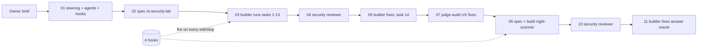

# How GhostWire was built with Kiro

12 headless Kiro sessions, about 230 credits in total (ledger sums). Every claim below traces to a session in [`docs/kiro-log/LEDGER.md`](kiro-log/LEDGER.md). That folder also has the exact prompt files and the raw Kiro CLI V3 `stream-json` transcripts. Run counts come from those transcripts.

## Surfaces and versions

- **Kiro CLI 3.2.0, V3 harness, headless** (`kiro-cli chat --v3 --no-interactive --output-format stream-json`), model `claude-opus-5.5`. Signed in with a Kiro account.
- `tools/kiro_bridge.py` wraps each headless session and writes the ledger entry. It lets a second terminal agent (omp, used as orchestrator and verifier) start Kiro work without doing the work itself. The rules for that split are in [`kiro-handoff.md`](kiro-handoff.md).
- The `.kiro/` files are the shared format, so the same agents, hooks and steering load in Kiro IDE.

Code that existed before Kiro took over is the C# baseline in commit `c3005fa`, disclosed in [`existing-code-disclosure.md`](existing-code-disclosure.md). Everything after it in `.kiro/`, `csharp/` and `frontend/` was written by Kiro sessions.

## Workflow

Session 06 rewrote the README. Session 08 was a deliberate demo in which the guard hook blocked a plant IP; it is used in the video.

## Spec-driven development

Kiro wrote two specs: `.kiro/specs/ot-security-lab/` (7 requirements, 28 tasks) and `.kiro/specs/night-scanner/` (7 requirements, 12+ tasks). Both use EARS acceptance criteria, a design with explicit **correctness properties**, and tasks that cite requirement IDs. Kiro wrote all of them from short briefs (`docs/kiro-log/prompts/`). Choices Kiro made that a vibe-coding pass would likely have missed:

- **Two simulators for the incident.** The forged FC06 write goes to a private, write-enabled simulator that is disposed before the HTTP server accepts requests. Learners read a separate read-only simulator. This kept the existing "writes are rejected" check true for every simulator a request can reach.
- **Wrong answers withhold the attacker's label.** A wrong submission never reveals the attacker label, so the AI explanation can't leak the answer either.
- **The suspicious row is flagged only after a correct answer**, so the exercise isn't given away.

Session 03 then ran the whole task list as the `ghostwire-builder` agent and checked off tasks 1–13. Task 14 (the security review) was deliberately left to a different agent.

## Property-based testing

The design's correctness properties became six seeded property tests in the dependency-free harness (`csharp/GhostWire.Tests`). There is no PBT library: Kiro wrote a SplitMix64 generator so a seed reproduces the same cases on any .NET version. Set the seed with `GHOSTWIRE_PBT_SEED`.

**PBT caught a real bug.** With seed 987654321, P-f failed: Windows reused a client port within one capture, so matching captured traffic by port alone picked the wrong exchange. The same failure could have happened at production startup. Kiro fixed it by matching on port plus transaction ID (session 09).

| Property | Cases per run |
|---|---|
| P-a: encode→decode round-trip for FC03/FC04/FC06 requests and responses | 600 |
| P-b: the decoder never throws on random bytes | 600 |
| P-c: every simulator response is exactly one of response / exception / timeout, and the register count matches the request | 200 |
| P-d: a timeout diagnosis never claims a single certain cause | 400 |
| P-e: the `frames` hex shown to the learner equals the bytes recorded on the socket | 200 |
| P-f: for any seeded Night Scanner plan, the scanner's unit IDs strictly increase and exactly one answer pair verifies | 48 |

P-e is the property that matters for a forensics trainer: the "wire evidence" panel cannot show bytes that weren't sent.

## Steering

| File | Inclusion | Purpose |
|---|---|---|
| `product.md` | always | audience, the four-step flow, tone |
| `safety.md` | always | simulation-only rules, plus an **evidence rule**: never state a Modbus result the simulator didn't return; a timeout never proves one cause |
| `tech.md` | always | stack, the `tools/dotnet` wrapper for `/mnt/d`, test command |
| `accessibility.md` | fileMatch `frontend/**` | text status labels, keyboard use, reduced motion |
| `modbus-protocol.md` | fileMatch `csharp/**/*.cs` | MBAP/PDU layouts, exception codes, zero-based addressing |

The fileMatch files load only when Kiro touches matching files, so protocol detail doesn't crowd the context during UI work. Every session transcript records which steering documents were included (`steeringDocuments` events).

## Custom agents (`.kiro/agents/*.md`)

- **ghostwire-builder** has read, write and shell tools. Its permission rules allow only `tools/dotnet *` and `git status/diff`, and deny `git push*` and `rm -rf*`. It ran every implementation session (03, 05, 06, 07, 09, 11).
- **ot-security-reviewer** is read-only, and shell is limited to `git diff*`. It reviewed each feature commit against eight checks: request-chosen hosts, learner-reachable writes, SSRF through the AI base URL, secrets, input bounds, decoder crashes, XSS and overclaiming.
  - Session 04 (Phantom Writer): 0 critical, high or medium issues, 3 low ones, which were fixed in session 05.
  - Session 10 (Night Scanner): 0 critical, high or medium issues, 4 low ones. One was an **answer oracle**: a wrong answer's shape revealed the correct row. All were fixed in session 11.
- **scenario-author** may write only to `docs/scenarios/**` and is used to design future cases.

Kiro also called its built-in `introspect` sub-agent to confirm current V3 file formats before writing any config.

## Agent hooks (`.kiro/hooks/*.json`), observed firing

| Hook | Trigger | What it did | Distinct runs in transcripts |
|---|---|---|---|
| `guard-no-physical-targets` | PreToolUse on `fs_write`/`fs_append`/`str_replace` | Runs `tools/hooks/guard_targets.py`, which blocks (exit 2) C# edits that add a non-loopback IPv4 literal, `0.0.0.0`, or a socket host taken from request JSON | 209 |
| `run-tests-after-csharp-change` | PostFileSave `csharp/**/*.cs` | Reruns the harness (property tests included) and feeds the failure output back to the agent | 89 |
| `scenario-docs-sync` | PostFileSave `Training.cs` (agent action) | Asks Kiro to update `docs/judge-quick-start.md` when scenario data changes; it did so when Phantom Writer and Night Scanner were added | 27 |
| `stop-verify` | Stop | Builds the server and makes the agent continue if compilation fails | 10 |

The guard hook turns the project's main safety rule into an enforced check rather than a request. Session 08 recorded it blocking a live request to hard-code `192.168.1.50`; that block is shown in the video.

## MCP

Kiro used no MCP server for the app itself. The orchestrator used the Devpost MCP server to pull the official rules, judging criteria and announcements quoted in `docs/bmad/win-plan.md`.

## What we learned

- The spec→tasks→builder loop with test-on-save produced 13 tasks of working code in one session, and a whole new incident case (spec + code + property test) in another. The hook output corrected failures without a human relaying them.
- Separating builder and reviewer agents, each with its own permissions, gave an independent review that could not edit what it was reviewing.
- A Windows build lock from concurrent hook runs once made the harness fail. Kiro noticed, waited and retried. `stop_build_check.py` treats lock-only errors as a warning so the Stop hook doesn't loop.
