# About this manual

GhostWire is an OT (operational technology) security and troubleshooting lab. It teaches technicians and students to investigate Modbus TCP faults and a security incident **from evidence**: real TCP exchanges with simulated devices on their own computer.

Everything is simulated. GhostWire never connects to physical equipment and never scans networks, and learners cannot send Modbus writes.

This manual has two parts:

- **Part A, user guide:** installing, the screen layout, and a step-by-step walkthrough of all five cases.
- **Part B, technical reference:** architecture, the Modbus TCP frame format, how the incident logs are produced, safety boundaries, the API, and verification.

Every screen in this manual was captured from GhostWire v1.1.0 running on Windows.

## Who it is for

| Person | What they learn |
|---|---|
| Technicians and apprentices | Read a Modbus register, interpret raw values, scale and units, and fix common configuration errors |
| Students (automation, ICS security) | How a Modbus TCP frame is built, byte by byte |
| OT security trainees | Investigate an unauthorised write and a unit-ID sweep from a traffic log |
| Trainers | Run repeatable, safe exercises without any lab hardware |

## The five cases at a glance

| Case | Type | Symptom | Lesson |
|---|---|---|---|
| The Giant Pressure | Troubleshooting, beginner | The raw value 39 is shown as 39 bar | The scale must come from the documentation (0.01) |
| The Silent Sensor | Troubleshooting, beginner | The read times out | The unit ID is wrong (17); a timeout alone proves nothing |
| The Wrong Register | Troubleshooting, intermediate | Exception 02, Illegal Data Address | The manual uses zero-based addresses (20, not 21) |
| Phantom Writer | Security incident, intermediate | The setpoint reads 95 °C instead of 65 °C | Find the one FC06 write in the traffic log |
| The Night Scanner | Security incident, intermediate | The process looks normal | Find the client that sweeps unit IDs |

# Part A · User guide

## 1. Install and start

### 1.1 Windows, no install (easiest)

1. Download `GhostWire-Windows-v1.1.1-standalone.zip` from <https://github.com/Wayan123/ghostwire-modbus-lab/releases/latest>. It is about 40 MB and includes the .NET runtime.
2. Unzip it and double-click `GhostWire.exe`. A console window opens. **Keep it open**, because it is the server.
3. Open <http://127.0.0.1:8000> in a browser.
4. Windows SmartScreen may warn because the file is unsigned. Choose **More info → Run anyway**.

A smaller zip (about 130 KB) on the same page needs the .NET 8 ASP.NET Core Runtime (x64) to be installed.

### 1.2 From source (any OS)

Install the .NET 8 SDK, then run this from the repository root:

```
dotnet run --project csharp/GhostWire/GhostWire.csproj
```

Open <http://127.0.0.1:8000> and stop the server with Ctrl+C. To use another port, set `GHOSTWIRE_PORT` (1–65535) before starting.

No hardware, account, AI key or NuGet package is needed.

## 2. The screen at a glance

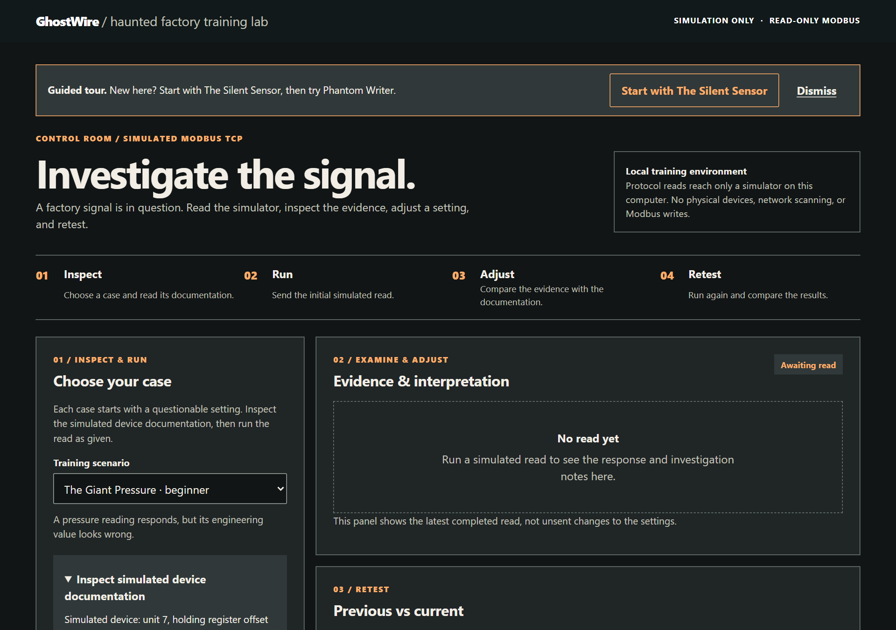

The page is divided into numbered sections:

| Section | Content |
|---|---|
| **01 / Inspect & Run** | **Choose your case**: the **Training scenario** picker (grouped into **Troubleshooting** and **Security incidents**, with the difficulty), the scenario summary, **Inspect simulated device documentation**, and the **Read request settings**: **Unit ID**, **Function code** (03 or 04), **Address**, **Quantity**, **Scale multiplier** and **Run simulated read** |
| **02 / Examine & Adjust** | **Evidence & interpretation**: the status, engineering value, raw registers, **Observations**, **Possible causes**, **Training hints**, **Next steps**, the **Verification** line, **Wire evidence (simulated frames)** and **Explanation** |
| **02B / Investigate the capture** | Security cases only: the **Simulated traffic log** and the answer form |
| **03 / Retest** | **Previous vs current**: compares the last two reads after you change a setting |
| **04 / Review** | **Case history & report**: every read and answer attempt in this session, and **Print case report** |

On a first visit, a **Guided tour** banner suggests starting with The Silent Sensor and then Phantom Writer. **Dismiss** hides it for this browser.

> If a setting is out of range (for example Unit ID 999), nothing is sent, and a message names the allowed range.

## 3. How every case works

1. **Choose the case** in **Training scenario**.
2. Open **Inspect simulated device documentation**. It is the "manual" of the simulated device, and it is the ground truth.
3. Press **Run simulated read** with the initial settings, and look at the evidence.
4. Compare the evidence with the documentation and change **one** setting.
5. Run the read again. The case is solved only when the **Verification** line says so.

`Verified` becomes true only when deterministic rules confirm that the settings match the documentation **and** the simulator gave a successful response. A plausible-looking number is not enough.

## 4. Case 1: The Giant Pressure

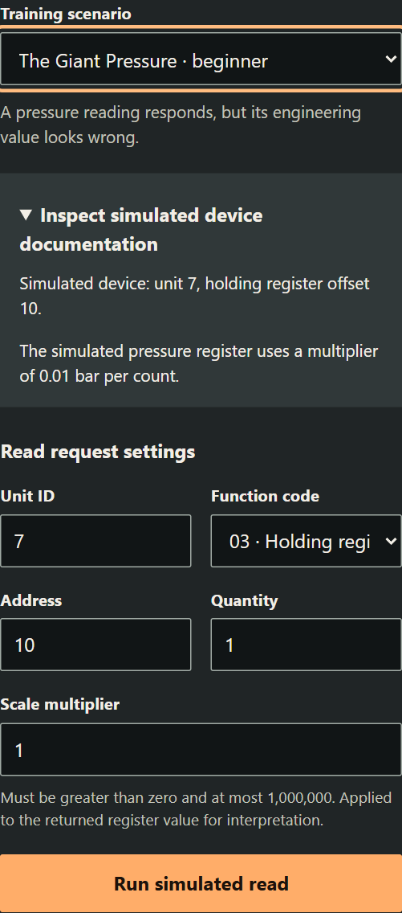

**Initial settings:** unit 7, FC03, address 10, quantity 1, scale 1.

1. Run the read. The simulator returns raw `39`, and with scale 1 the display shows 39 bar. That is far too high for this sensor.

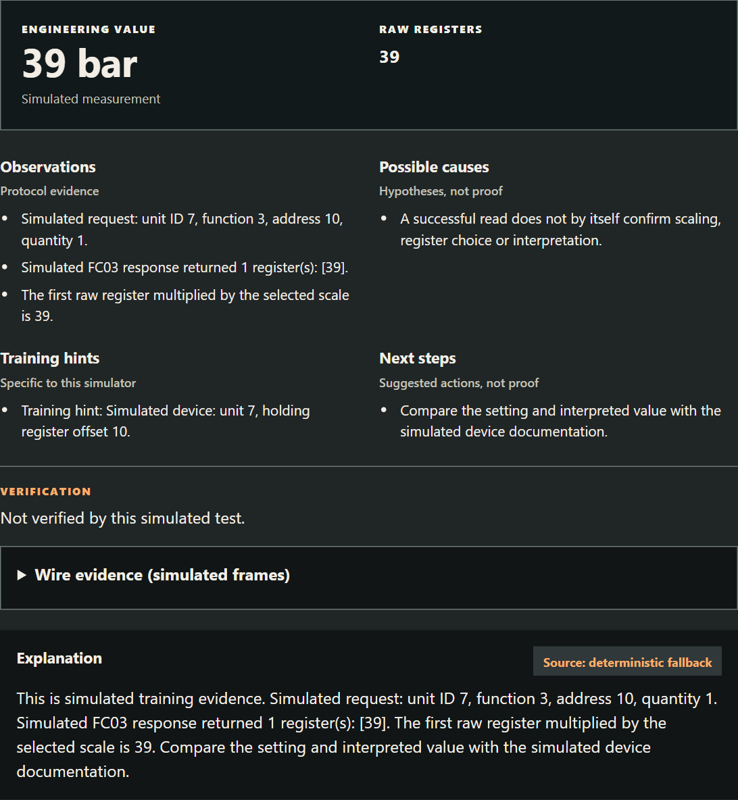

2. The documentation says the register holds pressure in **0.01 bar** units.
3. Set **Scale multiplier** to `0.01` and run again. The result is `0.39 bar`, verified.

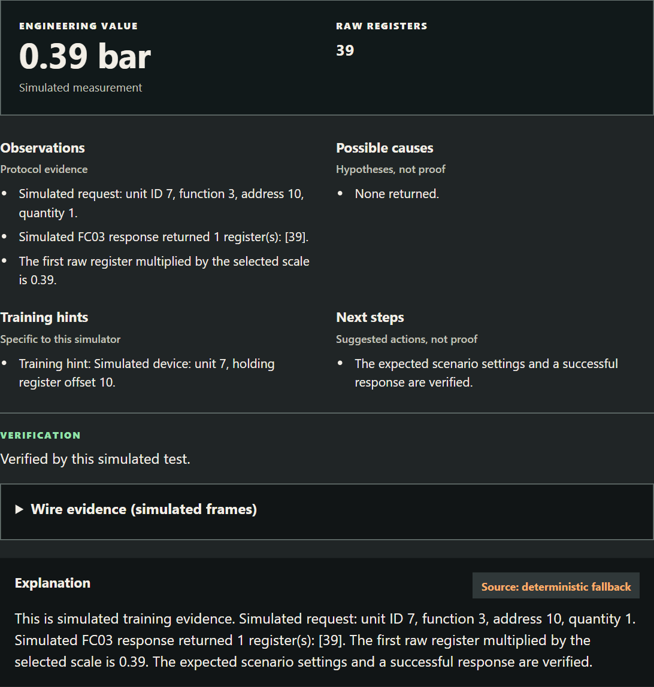

**Lesson:** a Modbus register holds an integer. The engineering value is raw × scale, and the scale always comes from the device manual.

## 5. Wire evidence: reading the bytes

Open **Wire evidence (simulated frames)** under the Verification line. It is available after every read in every case.

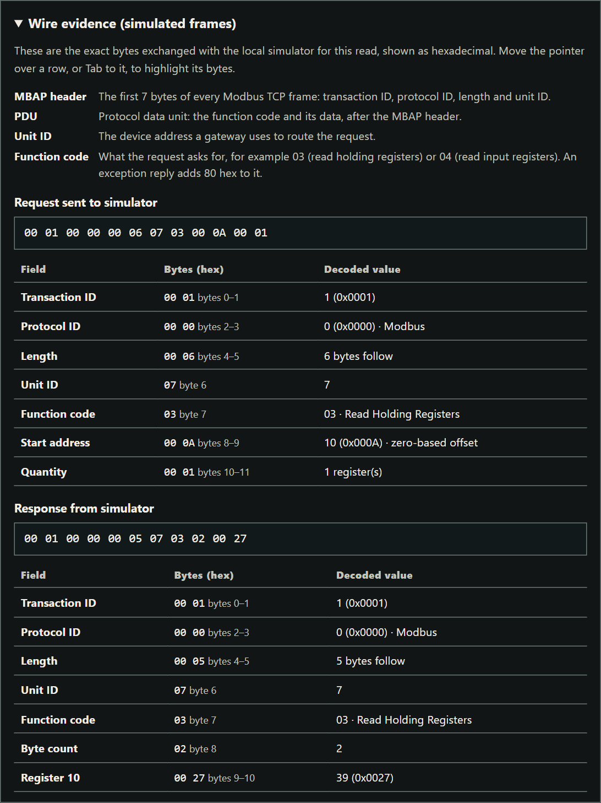

The corrected read sends:

```
00 01  00 00  00 06  07  03  00 0A  00 01
TxID   Proto  Len    Unit FC  Addr   Qty
```

and receives:

```
00 01  00 00  00 05  07  03  02     00 27
TxID   Proto  Len    Unit FC  Bytes  Value (0x0027 = 39)
```

Tab to a field row, or hover over it, to highlight its bytes. Each row also gives the byte range in text, such as "bytes 0–1" for the transaction ID. The panel defines the MBAP header, the PDU, the unit ID and the function code. After a timeout, only the request frame is shown, because no response arrived.

## 6. Case 2: The Silent Sensor

**Initial settings:** unit 1, FC04, address 0.

1. Run the read. It **times out**. Wire evidence shows only the request `00 01 00 00 00 06 01 04 00 00 00 01`.

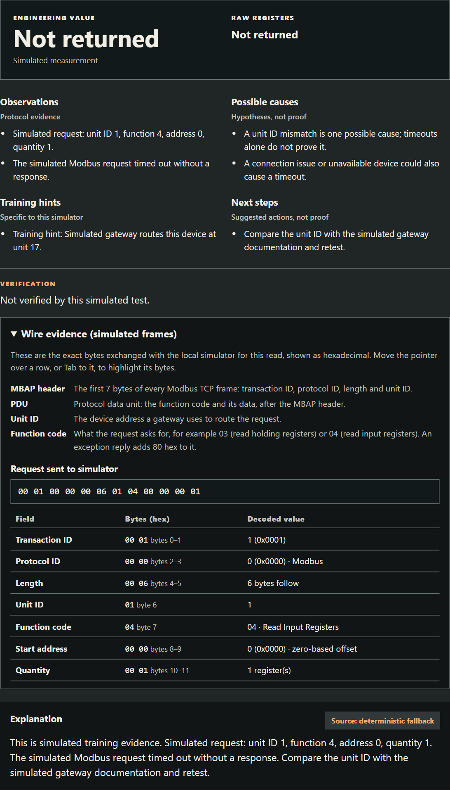

2. **Possible causes** lists a wrong unit ID, connection, routing and an unavailable device. All of them remain possible.
3. The documentation gives the device's unit ID as **17**. Set **Unit ID** to `17` and run again. The simulator returns raw `73`, verified.

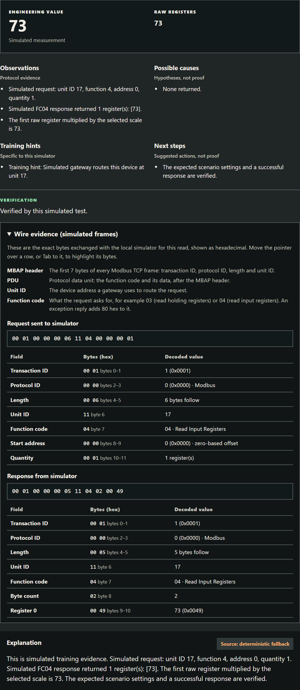

**Lesson:** the timeout did not prove that the unit ID was wrong. The successful retest with 17 is what verifies it.

## 7. Case 3: The Wrong Register

**Initial settings:** unit 3, FC04, address 21, quantity 1.

1. Run the read. The device answers with an **exception**. The response `00 01 00 00 00 03 03 84 02` decodes as function `84` (exception for 04) and exception code `02`, Illegal Data Address.

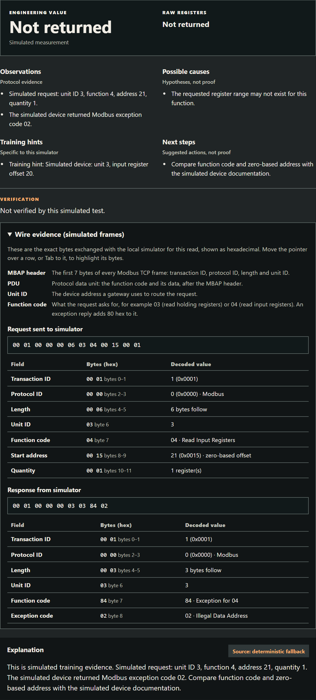

2. The training hint and the documentation give the register as unit 3, input register at **zero-based** offset 20.
3. Set **Address** to `20` and run again. The simulator returns raw `125`, verified.

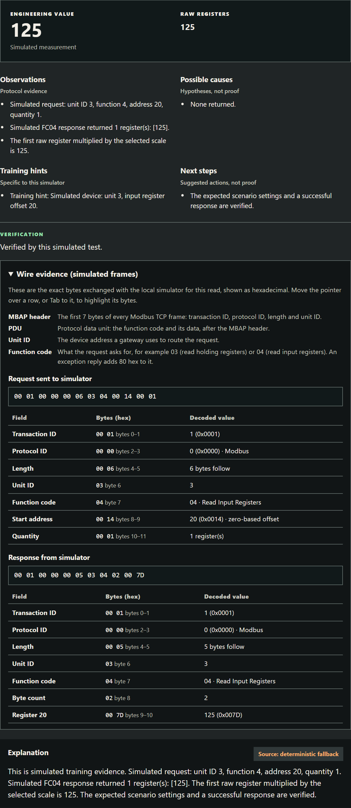

**Lesson:** manuals use different address conventions. "Register 21" in a one-based list is offset 20 on the wire.

## 8. Case 4: Phantom Writer (security incident)

**Initial settings:** unit 5, FC03, address 100, quantity 1, scale 0.1.

1. Run the read. The simulator returns raw `950`, shown as 95 °C. The documented normal setpoint is 650 (65.0 °C). The read confirms the current value, but it does not show who changed it.
2. Scroll to **02B / Investigate the capture**, the **Simulated traffic log**. It lists 12 captured transactions. Times show as HH:MM:SS (UTC), and hovering a time shows the full timestamp. **Show frames** on a row displays its bytes.

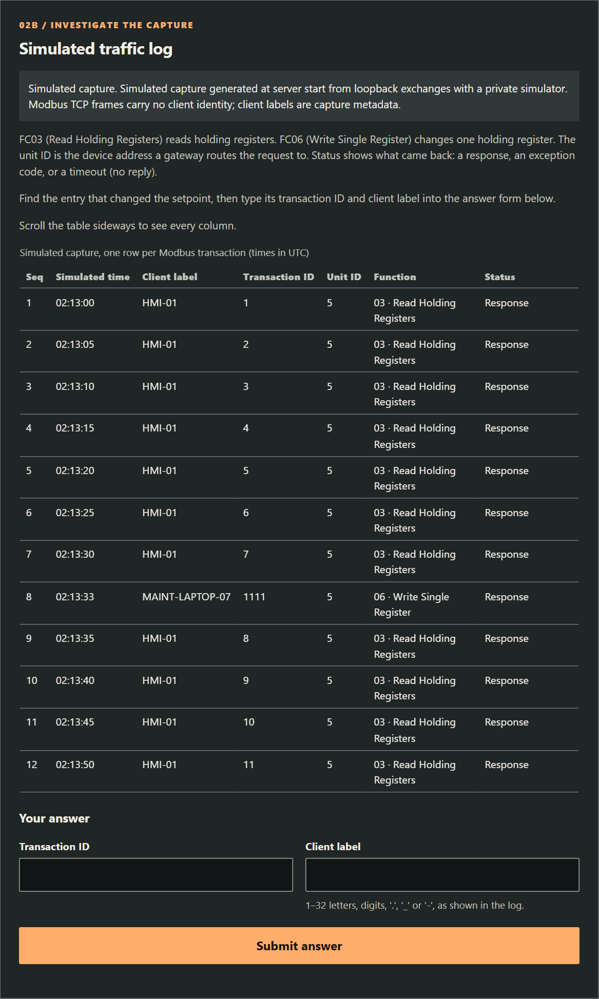

3. Find the entry that changed the setpoint: the one **FC06 (Write Single Register)** row. Note its transaction ID and client label.
4. Type them into **Transaction ID** and **Client label**, then press **Submit answer**.

A wrong pair returns "not verified" **without revealing the correct answer**. After 3 wrong answers a training hint appears, and a second one after the 4th. The hints never name the entry.

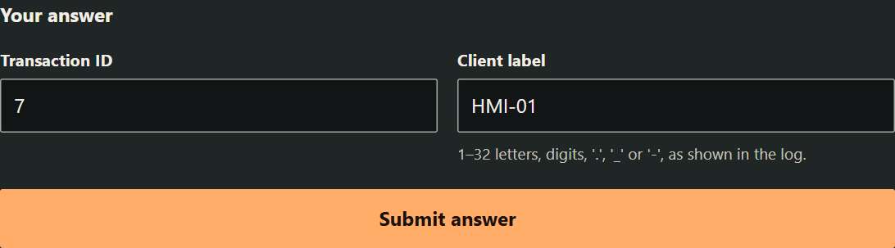

**Verified answer:** transaction `1111`, client `MAINT-LAPTOP-07`, at `2026-10-31T02:13:33Z`. This FC06 write changed register 100 from 650 to 950. The read before it (transaction 7) returned 650, and the read after it (transaction 8) returned 950.

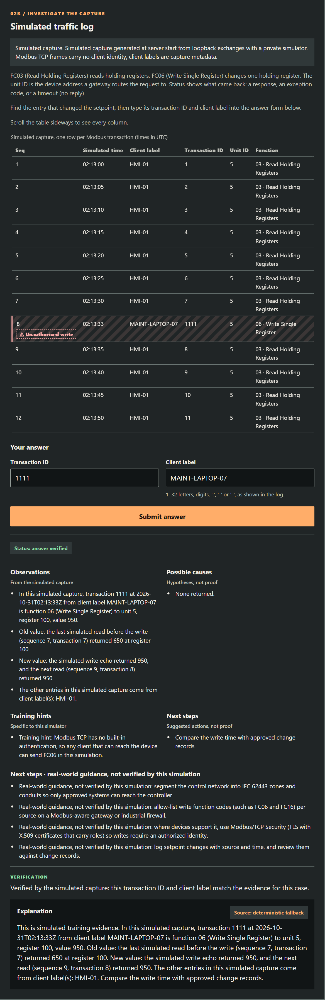

After verification, the row is marked **⚠ Unauthorized write**, and four mitigations appear under **Next steps · real-world guidance, not verified by this simulation**.

## 9. Case 5: The Night Scanner (security incident)

**Initial settings:** unit 5, FC03, address 100, scale 0.1.

1. Run the read. It returns raw `650` (65 °C), the documented normal value, and is verified. The process looks fine. A normal read does not show which other clients queried the gateway.
2. Open the **Simulated traffic log** (15 transactions). The **Status** column shows each result as text: "Response", "Timeout (no reply)" or "Exception 02 · Illegal Data Address". `HMI-01` polls unit 5 every 5 s (transactions 1–5).
3. Find the client that asks **many different unit IDs**, and submit the transaction ID of its **first** request and its client label.

Hint 1 (after 3 misses): "Look at the Unit ID column: does any client ask many different units?" Hint 2 (after 4 misses): "Find the first request in that run."

**Verified answer:** client `ENG-WS-13`, transaction `301` at `2026-11-01T03:12:07Z`. It sent 10 FC03 reads of address 0 to unit IDs 1–10, one second apart (transactions 301–310):

- 8 requests timed out;
- unit 5 returned exception 02, because it has no register 0;
- unit 9, which the documentation does not list, answered with raw 1.

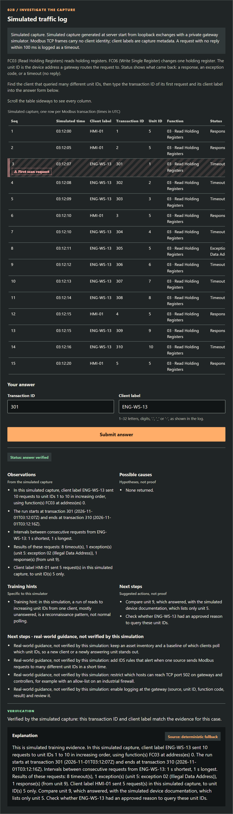

The mitigations shown are: an asset inventory and a polling baseline; IDS rules for unit-ID sweeps; restricting which hosts can reach port 502; and logging at the gateway. Reading unit 9 or unit 1 through the read form gives the same response or timeout as the log.

## 10. Case history and report

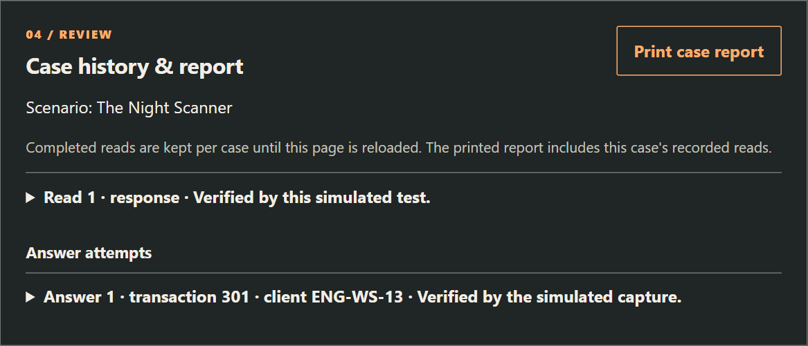

**04 / Review** (Case history & report) keeps each read (settings, status, values) and each answer attempt until the page is reloaded. **03 / Retest** (Previous vs current) compares the last two reads. **Print case report** opens the browser's print dialog, where you can print the report or save it as a PDF.

## 11. Phone and narrow screens

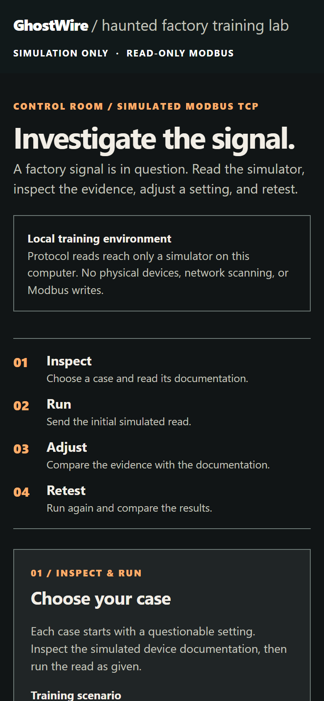

The layout adapts to narrow screens. The traffic log table scrolls sideways inside its own box.

## 12. Optional AI explanation

The **Explanation** panel normally shows a labelled, deterministic explanation. To use an OpenAI-compatible provider instead, set these in the **server environment** before starting:

```
GHOSTWIRE_AI_BASE_URL   (an OpenAI-compatible API base; /chat/completions is appended)
GHOSTWIRE_AI_MODEL
GHOSTWIRE_AI_API_KEY
```

The structured, simulated evidence (including frames) is sent to that provider, so review its terms first. The key stays on the server and is never returned. The server applies a 4 s deadline, ignores redirects, and caps the provider's reply. Provider text is labelled with its source, can be wrong, and never changes the protocol result. If the settings are missing or the call fails, the deterministic text is shown.

## 13. Troubleshooting

| Problem | What to do |
|---|---|
| The page does not open | Check that the console window is still open and shows "Now listening on: http://127.0.0.1:8000" |
| The port is already in use | Set `GHOSTWIRE_PORT` to another port and open that port |
| Error 429 | More than 120 requests per minute or 8 tests at once; wait a moment |
| "Retry loading scenarios" appears | The server stopped or restarted; start it again and press the button |
| The small zip does not start | Install the .NET 8 ASP.NET Core Runtime x64, or use the standalone zip |

# Part B · Technical reference

## 14. Architecture

```
Browser (frontend/: HTML, CSS, JS)
     │  HTTP on 127.0.0.1:8000
     ▼
ASP.NET Core server (C#, .NET 8)
  Program.cs  – HTTP hosting, Host/Origin checks, limits
  Training.cs – cases, validation, diagnosis, optional AI explanation
  Modbus.cs   – Modbus TCP client and simulators (FC03/FC04)
     │  Modbus TCP over loopback, ephemeral ports
     ▼
Read-only simulators, one per case (answer FC06 with exception 01)

At startup only:
  private write-enabled simulator ← scripted FC06 → captured bytes → Phantom Writer log
  private read-only gateway       ← scripted FC03 sweep → captured bytes → Night Scanner log
  (both are disposed before the server accepts requests)
```

There are no third-party NuGet packages. The frontend is plain HTML, CSS and JavaScript, with no build step.

## 15. Modbus TCP frame format

| Bytes | Field | Meaning |
|---|---|---|
| 0–1 | Transaction ID | Matches a response to its request |
| 2–3 | Protocol ID | Always `00 00` for Modbus |
| 4–5 | Length | The number of bytes that follow (unit + PDU) |
| 6 | Unit ID | The device behind a gateway |
| 7 | Function code | 03 Read Holding Registers, 04 Read Input Registers; +0x80 marks an exception |
| 8… | Data | The request: address and quantity. The response: a byte count and the values, or an exception code |

Exception codes used in the cases: `01` Illegal Function and `02` Illegal Data Address.

## 16. How the incident logs are produced

The traffic logs are **not hand-written**. At startup, under a 5 s overall deadline:

- **Phantom Writer:** a scripted client sends reads and one FC06 to a private, write-enabled loopback simulator. The bytes actually sent and received are decoded into the 12-row log.
- **Night Scanner:** 15 FC03 steps run against a private, read-only gateway simulator that holds unit 5 (register 100 = 650) and unit 9 (register 0 = 1). `HMI-01` polls unit 5 every 5 simulated seconds. `ENG-WS-13` reads address 0 from unit IDs 1–10, one per simulated second. A timeout is logged only when the 100 ms deadline expired and the simulator recorded that it sent nothing.

Both simulators are disposed before the server accepts any HTTP request. Modbus TCP frames carry no client identity, so the client labels are capture metadata.

## 17. Safety boundaries

| Boundary | How it is enforced |
|---|---|
| No physical equipment | The server listens on loopback only; requests cannot choose a host, port or URL |
| No learner writes | `/api/test` accepts only FC03 and FC04; the client refuses to build any other function code; every learner-reachable simulator answers FC06 with exception 01 |
| No network scanning | The Night Scanner sweep is 10 reads against a private loopback simulator at startup |
| Browser hardening | Host and Origin are restricted to the local origin |
| Resource limits | Requests up to 16 KiB; 120 per minute; 8 concurrent tests; excess gets 429 |
| No answer oracle | A wrong answer returns the same "not verified" response regardless of which part is wrong |

Simulated results say nothing about the safety or condition of a real installation. The Modbus code is a deliberately narrow FC03/FC04 implementation for training. It is not a general-purpose or safety-certified library.

## 18. HTTP API (local)

| Method and path | Purpose |
|---|---|
| `GET /api/scenarios` | The list of cases with their summary, documentation, category and difficulty |
| `POST /api/test` | Run one read: `unit_id`, `function_code` (3 or 4), `address`, `quantity`, `scale`, and the scenario ID |
| `GET /api/incident/{scenario_id}/log` | The simulated traffic log of a security case |
| `POST /api/incident/answer` | Submit a transaction ID and client label |

The responses separate **observations** (status, raw registers, frames, verified) from **interpretation** (possible causes, hints, next steps, explanation). Scenario IDs are `pressure-scaling`, `unit-id`, `register-addressing`, `phantom-writer` and `night-scanner`.

## 19. Verification

```
dotnet build csharp/GhostWire/GhostWire.csproj
dotnet run --project csharp/GhostWire.Tests/GhostWire.Tests.csproj
```

The test harness uses real loopback TCP and HTTP. It covers all five cases, the frame inspector, the incident logs and answers, input validation, request bounds and the Host/Origin checks. It also runs seeded property-based tests: codec round-trip, decoder totality, transport status, timeout diagnosis, "frames equal wire bytes", and Night Scanner plans. The seed is printed, and `GHOSTWIRE_PBT_SEED` reproduces a run. No external AI provider or physical device is tested. Observed checks are recorded in `docs/verification.md`.

## 20. License and credits

Apache-2.0. Built for Kiroween 2026 with Kiro: specs in `.kiro/specs`, custom agents, hooks (tests after C# changes, a guard against physical targets, docs sync and a stop check), and a session ledger in `docs/kiro-log/LEDGER.md`. Pre-existing code is disclosed in `docs/existing-code-disclosure.md`.
