# Tentang manual ini

GhostWire adalah laboratorium keamanan dan pemecahan masalah OT (*operational technology*). GhostWire melatih teknisi dan siswa menyelidiki gangguan Modbus TCP dan sebuah insiden keamanan **berdasarkan bukti**, yaitu pertukaran TCP nyata dengan perangkat simulasi di komputer mereka sendiri.

Semuanya simulasi. GhostWire tidak pernah terhubung ke peralatan fisik dan tidak pernah memindai jaringan, dan peserta tidak dapat mengirim penulisan Modbus.

Manual ini terdiri dari dua bagian:

- **Bagian A, panduan pengguna:** pemasangan, tata letak layar, dan panduan langkah demi langkah untuk kelima kasus.
- **Bagian B, referensi teknis:** arsitektur, format frame Modbus TCP, cara log insiden dihasilkan, batas keselamatan, API, dan verifikasi.

Semua tampilan di manual ini diambil dari GhostWire v1.1.0 yang berjalan di Windows. Antarmuka GhostWire berbahasa Inggris. Nama tombol dan kolom ditulis persis seperti di layar, dan artinya dijelaskan dalam bahasa Indonesia.

## Untuk siapa

| Pengguna | Yang dipelajari |
|---|---|
| Teknisi dan peserta magang | Membaca register Modbus, menafsirkan nilai mentah, skala, dan satuan, serta memperbaiki kesalahan konfigurasi yang umum |
| Siswa (otomasi, keamanan ICS) | Bagaimana frame Modbus TCP disusun, byte demi byte |
| Peserta pelatihan keamanan OT | Menyelidiki penulisan tanpa izin dan penyisiran (sweep) unit ID dari log lalu lintas |
| Pelatih | Menjalankan latihan yang aman dan dapat diulang tanpa perangkat keras laboratorium |

## Ringkasan lima kasus

| Kasus | Jenis | Gejala | Pelajaran |
|---|---|---|---|
| The Giant Pressure | Pemecahan masalah, pemula | Nilai mentah 39 ditampilkan sebagai 39 bar | Skala harus diambil dari dokumentasi (0,01) |
| The Silent Sensor | Pemecahan masalah, pemula | Pembacaan timeout | Unit ID salah (17); timeout saja tidak membuktikan apa-apa |
| The Wrong Register | Pemecahan masalah, menengah | Exception 02, Illegal Data Address | Manual memakai alamat berbasis nol (20, bukan 21) |
| Phantom Writer | Insiden keamanan, menengah | Setpoint terbaca 95 °C, bukan 65 °C | Temukan satu-satunya penulisan FC06 di log lalu lintas |
| The Night Scanner | Insiden keamanan, menengah | Proses terlihat normal | Temukan klien yang menyisir unit ID |

# Bagian A · Panduan pengguna

## 1. Memasang dan menjalankan

### 1.1 Windows tanpa instalasi (paling mudah)

1. Unduh `GhostWire-Windows-v1.1.0-standalone.zip` dari <https://github.com/Wayan123/ghostwire-modbus-lab/releases/latest>. Ukurannya sekitar 40 MB dan sudah berisi runtime .NET.
2. Ekstrak, lalu klik dua kali `GhostWire.exe`. Jendela konsol akan terbuka. **Biarkan tetap terbuka**, karena itulah servernya.
3. Buka <http://127.0.0.1:8000> di browser.
4. Windows SmartScreen dapat memperingatkan karena file belum ditandatangani. Pilih **More info → Run anyway**.

Zip yang lebih kecil (sekitar 130 KB) di halaman yang sama memerlukan .NET 8 ASP.NET Core Runtime (x64) yang sudah terpasang.

### 1.2 Dari source code (semua OS)

Pasang .NET 8 SDK, lalu jalankan perintah ini dari folder root repositori:

```
dotnet run --project csharp/GhostWire/GhostWire.csproj
```

Buka <http://127.0.0.1:8000>, dan hentikan server dengan Ctrl+C. Untuk memakai port lain, atur `GHOSTWIRE_PORT` (1–65535) sebelum menjalankan.

Tidak diperlukan perangkat keras, akun, kunci AI, atau paket NuGet.

## 2. Sekilas tampilan layar

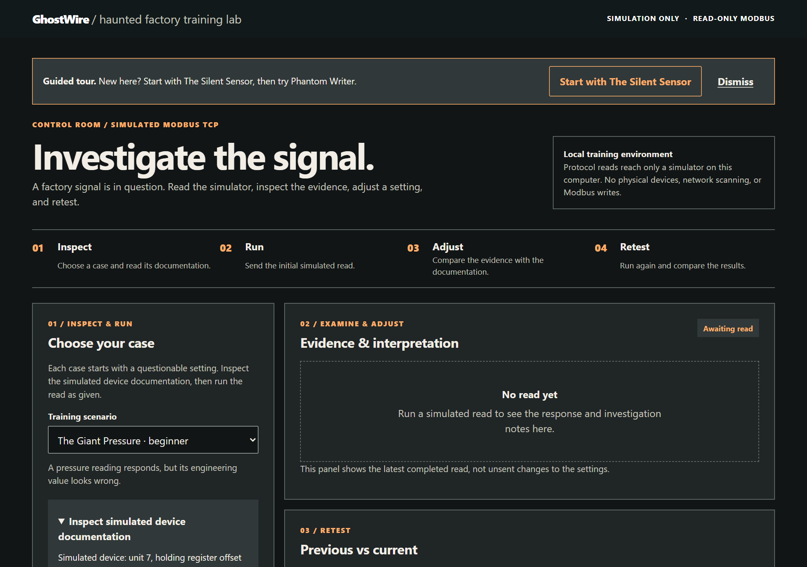

Halaman dibagi menjadi beberapa bagian bernomor:

| Bagian | Isi |
|---|---|
| **01 / Inspect & Run** | **Choose your case**: pemilih **Training scenario** (dikelompokkan menjadi **Troubleshooting** dan **Security incidents**, dengan tingkat kesulitannya), ringkasan skenario, **Inspect simulated device documentation**, dan **Read request settings**: **Unit ID**, **Function code** (03 atau 04), **Address**, **Quantity**, **Scale multiplier**, serta tombol **Run simulated read** |
| **02 / Examine & Adjust** | **Evidence & interpretation**: status, nilai engineering, register mentah, **Observations** (pengamatan), **Possible causes** (kemungkinan penyebab), **Training hints** (petunjuk latihan), **Next steps** (langkah berikutnya), baris **Verification**, **Wire evidence (simulated frames)**, dan **Explanation** |
| **02B / Investigate the capture** | Khusus kasus keamanan: **Simulated traffic log** (log lalu lintas simulasi) dan formulir jawaban |
| **03 / Retest** | **Previous vs current**: membandingkan dua pembacaan terakhir setelah Anda mengubah pengaturan |
| **04 / Review** | **Case history & report**: semua pembacaan dan percobaan jawaban di sesi ini, serta **Print case report** |

Saat pertama kali dibuka, banner **Guided tour** menyarankan mulai dari The Silent Sensor, lalu Phantom Writer. Tombol **Dismiss** menyembunyikannya untuk browser ini.

> Jika ada pengaturan di luar rentang (misalnya Unit ID 999), tidak ada yang dikirim, dan pesan akan menyebut rentang yang diizinkan.

## 3. Cara kerja setiap kasus

1. **Pilih kasus** di **Training scenario**.
2. Buka **Inspect simulated device documentation**. Inilah "manual" perangkat simulasi, dan inilah acuan kebenarannya.
3. Tekan **Run simulated read** dengan pengaturan awal, lalu amati buktinya.
4. Bandingkan bukti dengan dokumentasi, lalu ubah **satu** pengaturan.
5. Jalankan pembacaan lagi. Kasus baru selesai bila baris **Verification** menyatakan terverifikasi.

Status `Verified` hanya menjadi benar bila aturan deterministik memastikan pengaturan sesuai dokumentasi **dan** simulator memberi respons yang berhasil. Angka yang tampak masuk akal saja tidak cukup.

## 4. Kasus 1: The Giant Pressure

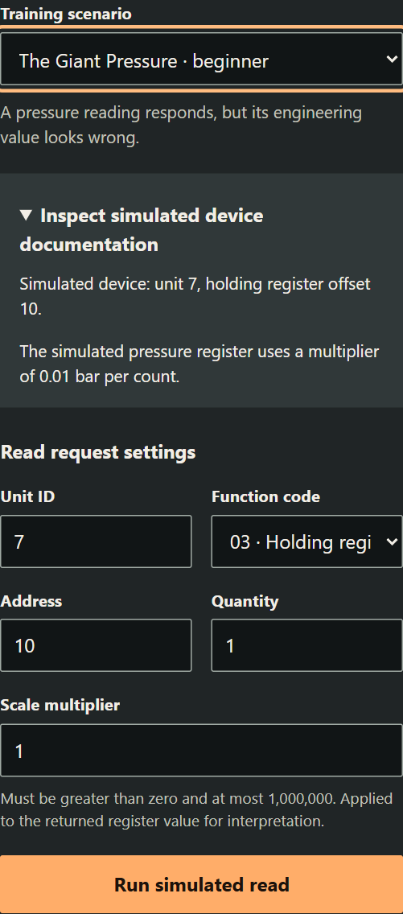

**Pengaturan awal:** unit 7, FC03, alamat 10, quantity 1, skala 1.

1. Jalankan pembacaan. Simulator mengembalikan nilai mentah `39`, dan dengan skala 1 tampilannya 39 bar. Nilai itu terlalu tinggi untuk sensor ini.

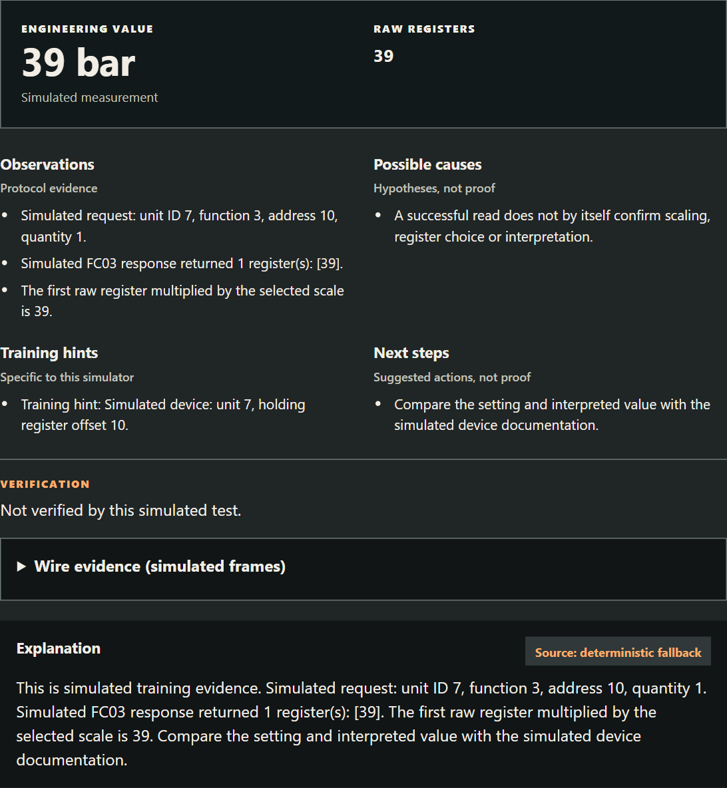

2. Dokumentasi menyebutkan register berisi tekanan dalam satuan **0,01 bar**.
3. Ubah **Scale multiplier** menjadi `0.01`, lalu jalankan lagi. Hasilnya `0.39 bar`, terverifikasi.

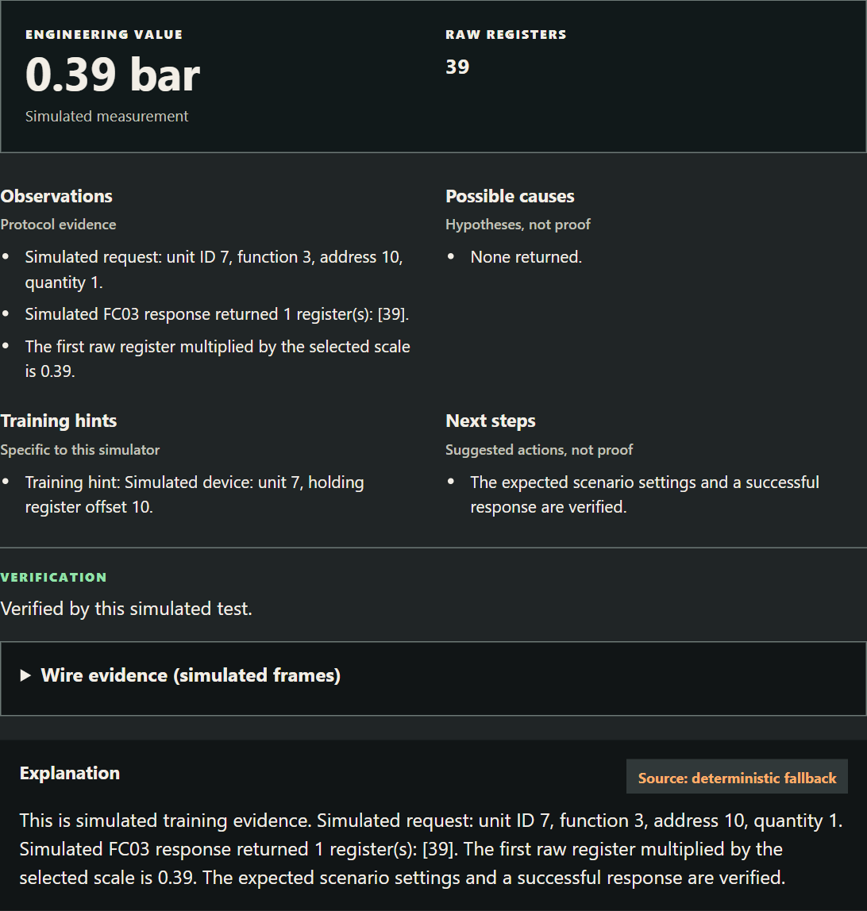

**Pelajaran:** register Modbus berisi bilangan bulat. Nilai engineering adalah nilai mentah × skala, dan skala selalu diambil dari manual perangkat.

## 5. Wire evidence: membaca byte

Buka **Wire evidence (simulated frames)** di bawah baris Verification. Panel ini tersedia setelah setiap pembacaan di semua kasus.

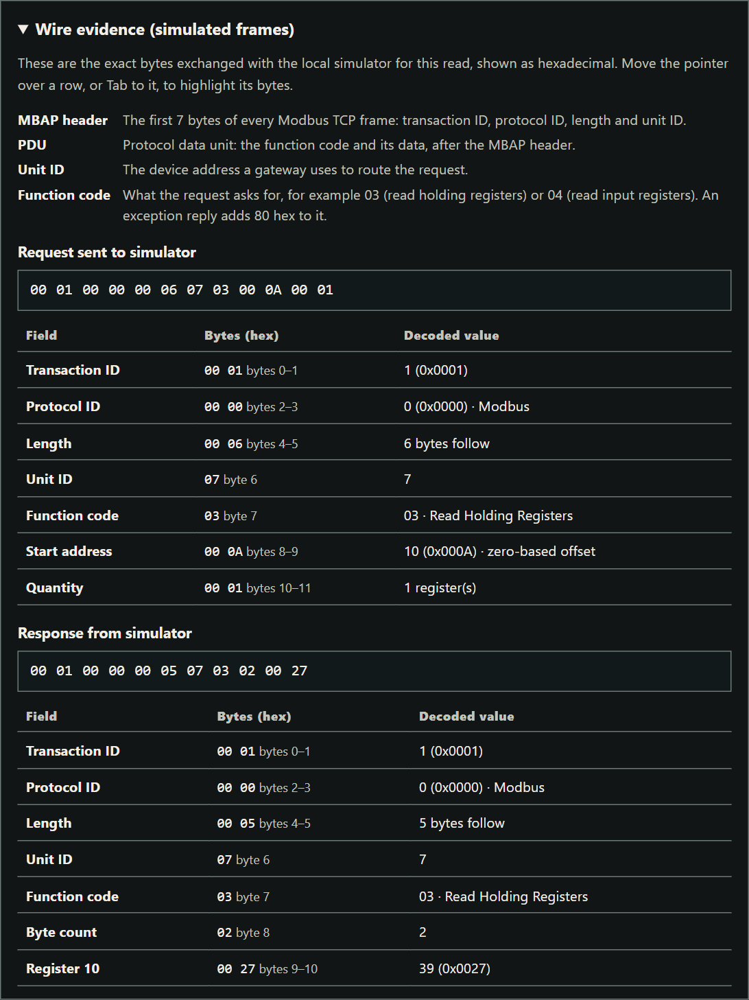

Pembacaan yang benar mengirim:

```
00 01  00 00  00 06  07  03  00 0A  00 01
TxID   Proto  Len    Unit FC  Addr   Qty
```

dan menerima:

```
00 01  00 00  00 05  07  03  02     00 27
TxID   Proto  Len    Unit FC  Bytes  Nilai (0x0027 = 39)
```

Tekan Tab ke baris sebuah kolom, atau arahkan kursor ke sana, untuk menyorot byte-nya. Setiap baris juga menyebut rentang byte dalam teks, misalnya "bytes 0–1" untuk transaction ID. Panel ini menjelaskan header MBAP, PDU, unit ID, dan kode fungsi. Setelah timeout, hanya frame permintaan yang ditampilkan, karena tidak ada jawaban yang datang.

## 6. Kasus 2: The Silent Sensor

**Pengaturan awal:** unit 1, FC04, alamat 0.

1. Jalankan pembacaan. Hasilnya **timeout**. Wire evidence hanya menampilkan permintaan `00 01 00 00 00 06 01 04 00 00 00 01`.

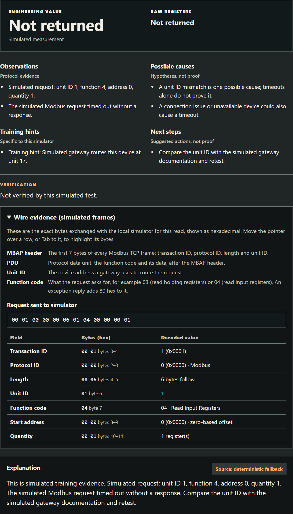

2. **Possible causes** menyebut unit ID yang salah, koneksi, routing, dan perangkat yang tidak tersedia. Semuanya masih mungkin.
3. Dokumentasi menyebut unit ID perangkat adalah **17**. Ubah **Unit ID** menjadi `17`, lalu jalankan lagi. Simulator mengembalikan nilai mentah `73`, terverifikasi.

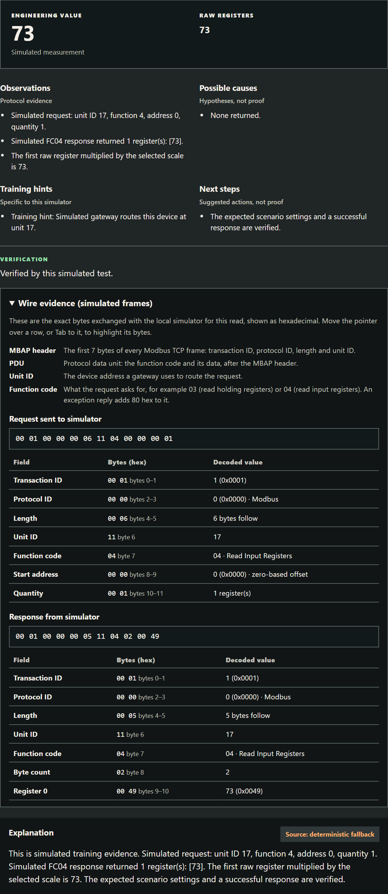

**Pelajaran:** timeout tidak membuktikan bahwa unit ID-nya salah. Uji ulang yang berhasil dengan 17 itulah yang membuktikannya.

## 7. Kasus 3: The Wrong Register

**Pengaturan awal:** unit 3, FC04, alamat 21, quantity 1.

1. Jalankan pembacaan. Perangkat menjawab dengan **exception**. Respons `00 01 00 00 00 03 03 84 02` didekode sebagai fungsi `84` (exception untuk 04) dan kode exception `02`, Illegal Data Address.

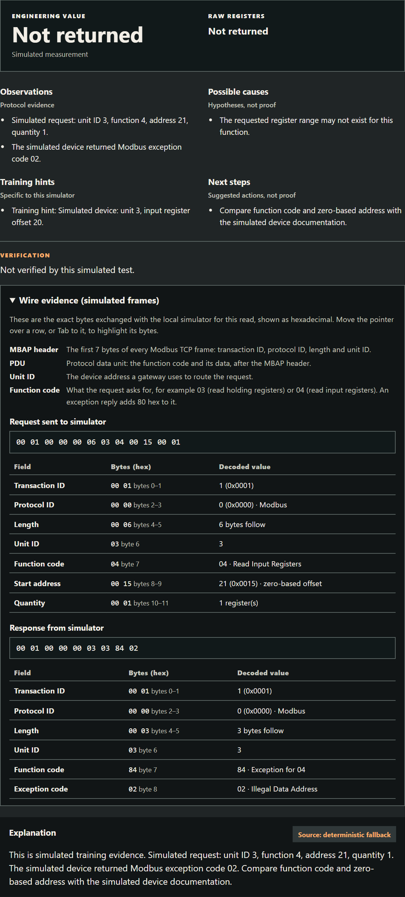

2. Petunjuk latihan dan dokumentasi menyebut register itu sebagai unit 3, input register pada offset **berbasis nol** 20.
3. Ubah **Address** menjadi `20`, lalu jalankan lagi. Simulator mengembalikan nilai mentah `125`, terverifikasi.

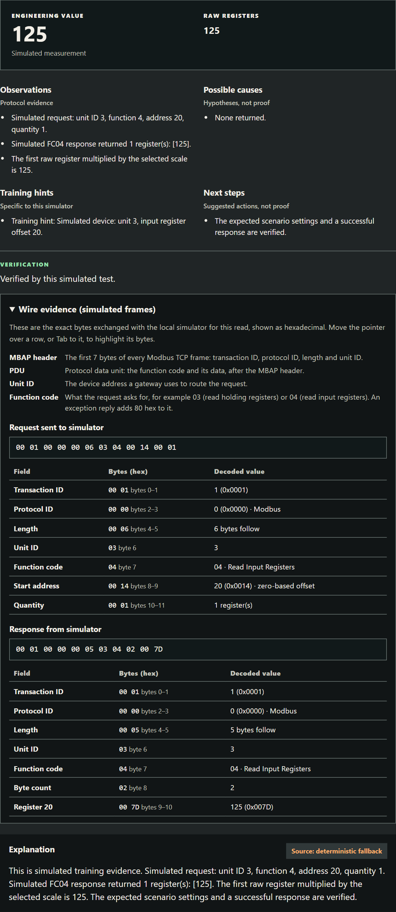

**Pelajaran:** manual memakai konvensi alamat yang berbeda-beda. "Register 21" di daftar berbasis satu adalah offset 20 di kabel.

## 8. Kasus 4: Phantom Writer (insiden keamanan)

**Pengaturan awal:** unit 5, FC03, alamat 100, quantity 1, skala 0,1.

1. Jalankan pembacaan. Simulator mengembalikan nilai mentah `950`, ditampilkan sebagai 95 °C. Setpoint normal menurut dokumentasi adalah 650 (65,0 °C). Pembacaan ini memastikan nilai saat ini, tetapi tidak menunjukkan siapa yang mengubahnya.
2. Gulir ke **02B / Investigate the capture**, yaitu **Simulated traffic log**. Log ini berisi 12 transaksi yang terekam. Waktu ditampilkan sebagai HH:MM:SS (UTC), dan mengarahkan kursor ke waktu menampilkan cap waktu lengkapnya. Tombol **Show frames** di sebuah baris menampilkan byte-nya.

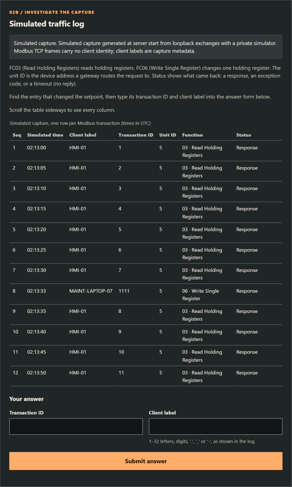

3. Temukan entri yang mengubah setpoint: satu-satunya baris **FC06 (Write Single Register)**. Catat transaction ID dan label kliennya.
4. Ketik keduanya di **Transaction ID** dan **Client label**, lalu tekan **Submit answer**.

Pasangan yang salah menghasilkan "not verified" **tanpa membocorkan jawaban yang benar**. Setelah 3 jawaban salah muncul petunjuk latihan, dan petunjuk kedua muncul setelah jawaban ke-4. Petunjuk tidak pernah menyebut entrinya.

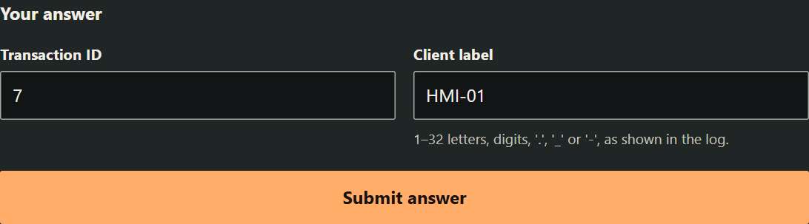

**Jawaban terverifikasi:** transaksi `1111`, klien `MAINT-LAPTOP-07`, pada `2026-10-31T02:13:33Z`. Penulisan FC06 ini mengubah register 100 dari 650 menjadi 950. Pembacaan sebelumnya (transaksi 7) mengembalikan 650, dan pembacaan sesudahnya (transaksi 8) mengembalikan 950.

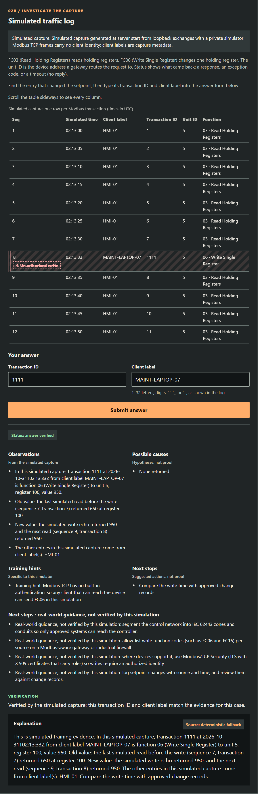

Setelah terverifikasi, baris itu diberi tanda **⚠ Unauthorized write** (penulisan tanpa izin), dan empat mitigasi muncul di bawah **Next steps · real-world guidance, not verified by this simulation** (panduan dunia nyata, tidak diverifikasi oleh simulasi ini).

## 9. Kasus 5: The Night Scanner (insiden keamanan)

**Pengaturan awal:** unit 5, FC03, alamat 100, skala 0,1.

1. Jalankan pembacaan. Hasilnya nilai mentah `650` (65 °C), sesuai nilai normal di dokumentasi, dan terverifikasi. Proses tampak baik-baik saja. Pembacaan normal tidak menunjukkan klien lain mana yang menanyai gateway.
2. Buka **Simulated traffic log** (15 transaksi). Kolom **Status** menampilkan hasil setiap transaksi sebagai teks: "Response", "Timeout (no reply)", atau "Exception 02 · Illegal Data Address". `HMI-01` mem-polling unit 5 setiap 5 detik (transaksi 1–5).
3. Temukan klien yang menanyakan **banyak unit ID yang berbeda**, lalu kirim transaction ID dari permintaan **pertamanya** dan label kliennya.

Petunjuk 1 (setelah 3 kali salah): "Look at the Unit ID column: does any client ask many different units?" Petunjuk 2 (setelah 4 kali salah): "Find the first request in that run."

**Jawaban terverifikasi:** klien `ENG-WS-13`, transaksi `301` pada `2026-11-01T03:12:07Z`. Klien ini mengirim 10 pembacaan FC03 ke alamat 0 untuk unit ID 1–10, berselang satu detik (transaksi 301–310):

- 8 permintaan timeout;
- unit 5 mengembalikan exception 02, karena tidak punya register 0;
- unit 9, yang tidak tercantum di dokumentasi, menjawab dengan nilai mentah 1.

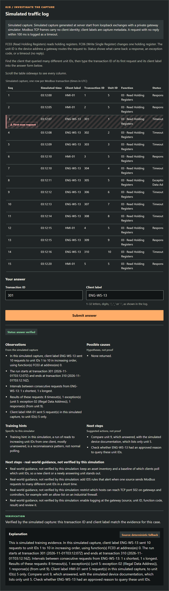

Mitigasi yang ditampilkan adalah: inventaris aset dan baseline polling; aturan IDS untuk penyisiran unit ID; pembatasan host yang boleh menjangkau port 502; dan logging di gateway. Membaca unit 9 atau unit 1 lewat formulir pembacaan memberi respons atau timeout yang sama dengan log.

## 10. Riwayat kasus dan laporan

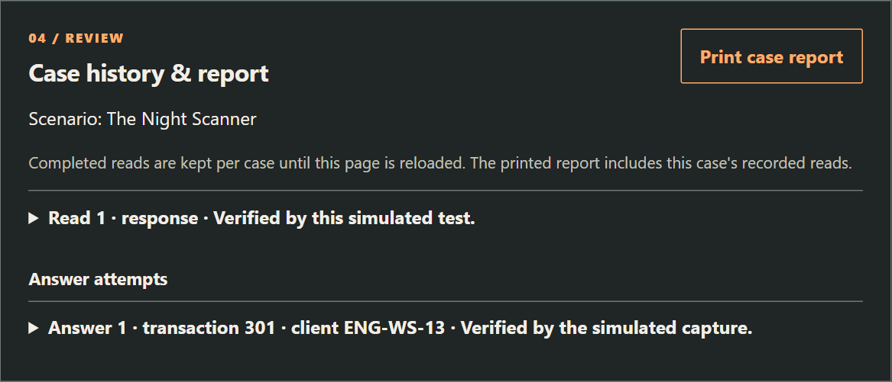

**04 / Review** (Case history & report) menyimpan setiap pembacaan (pengaturan, status, nilai) dan setiap percobaan jawaban sampai halaman dimuat ulang. **03 / Retest** (Previous vs current) membandingkan dua pembacaan terakhir. **Print case report** membuka dialog cetak browser, tempat Anda dapat mencetak laporan atau menyimpannya sebagai PDF.

## 11. Ponsel dan layar sempit

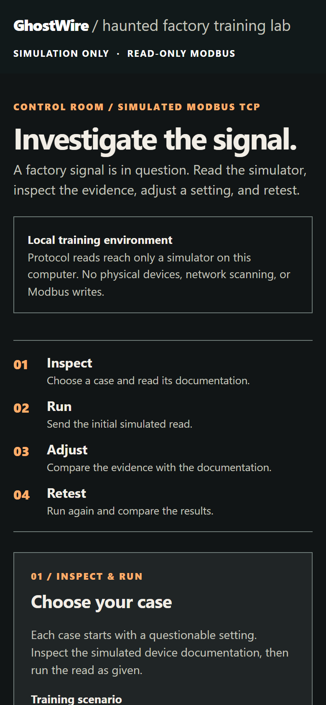

Tata letak menyesuaikan diri dengan layar sempit. Tabel log lalu lintas dapat digulir ke samping di dalam kotaknya sendiri.

## 12. Penjelasan AI (opsional)

Panel **Explanation** biasanya menampilkan penjelasan deterministik yang diberi label. Untuk memakai penyedia yang kompatibel dengan OpenAI, atur variabel ini di **lingkungan server** sebelum menjalankan:

```
GHOSTWIRE_AI_BASE_URL   (basis API kompatibel OpenAI; /chat/completions ditambahkan)
GHOSTWIRE_AI_MODEL
GHOSTWIRE_AI_API_KEY
```

Bukti simulasi yang terstruktur (termasuk frame) dikirim ke penyedia tersebut, jadi periksa dulu ketentuannya. Kunci API tetap di server dan tidak pernah dikembalikan ke browser. Server memberi batas waktu 4 detik, tidak mengikuti redirect, dan membatasi ukuran jawaban penyedia. Teks dari penyedia diberi label sumbernya, bisa saja salah, dan tidak pernah mengubah hasil protokol. Bila pengaturan tidak ada atau panggilan gagal, teks deterministik yang ditampilkan.

## 13. Pemecahan masalah

| Masalah | Yang dilakukan |
|---|---|
| Halaman tidak terbuka | Pastikan jendela konsol masih terbuka dan menampilkan "Now listening on: http://127.0.0.1:8000" |
| Port sudah dipakai | Atur `GHOSTWIRE_PORT` ke port lain, lalu buka port tersebut |
| Error 429 | Lebih dari 120 permintaan per menit atau 8 tes sekaligus; tunggu sebentar |
| Muncul "Retry loading scenarios" | Server berhenti atau dimulai ulang; jalankan lagi lalu tekan tombol itu |
| Zip kecil tidak bisa jalan | Pasang .NET 8 ASP.NET Core Runtime x64, atau pakai zip standalone |

# Bagian B · Referensi teknis

## 14. Arsitektur

```
Browser (frontend/: HTML, CSS, JS)
     │  HTTP di 127.0.0.1:8000
     ▼
Server ASP.NET Core (C#, .NET 8)
  Program.cs  – hosting HTTP, pemeriksaan Host/Origin, batasan
  Training.cs – kasus, validasi, diagnosis, penjelasan AI opsional
  Modbus.cs   – klien Modbus TCP dan simulator (FC03/FC04)
     │  Modbus TCP lewat loopback, port sementara
     ▼
Simulator hanya-baca, satu per kasus (menjawab FC06 dengan exception 01)

Hanya saat startup:
  simulator privat yang bisa ditulis ← FC06 terskrip → byte terekam → log Phantom Writer
  gateway privat hanya-baca           ← sweep FC03 terskrip → byte terekam → log Night Scanner
  (keduanya dibuang sebelum server menerima permintaan)
```

Tidak ada paket NuGet pihak ketiga. Frontend berupa HTML, CSS, dan JavaScript biasa tanpa proses build.

## 15. Format frame Modbus TCP

| Byte | Kolom | Arti |
|---|---|---|
| 0–1 | Transaction ID | Mencocokkan respons dengan permintaannya |
| 2–3 | Protocol ID | Selalu `00 00` untuk Modbus |
| 4–5 | Length | Jumlah byte yang mengikuti (unit + PDU) |
| 6 | Unit ID | Perangkat di belakang gateway |
| 7 | Function code | 03 Read Holding Registers, 04 Read Input Registers; +0x80 menandai exception |
| 8… | Data | Permintaan: alamat dan jumlah. Respons: jumlah byte dan nilainya, atau kode exception |

Kode exception yang dipakai dalam kasus: `01` Illegal Function dan `02` Illegal Data Address.

## 16. Cara log insiden dihasilkan

Log lalu lintas **tidak ditulis tangan**. Saat startup, dengan batas waktu total 5 detik:

- **Phantom Writer:** klien terskrip mengirim beberapa pembacaan dan satu FC06 ke simulator loopback privat yang bisa ditulis. Byte yang benar-benar dikirim dan diterima didekode menjadi log 12 baris.
- **Night Scanner:** 15 langkah FC03 dijalankan terhadap simulator gateway privat hanya-baca yang memuat unit 5 (register 100 = 650) dan unit 9 (register 0 = 1). `HMI-01` mem-polling unit 5 setiap 5 detik simulasi. `ENG-WS-13` membaca alamat 0 dari unit ID 1–10, satu per detik simulasi. Timeout baru dicatat bila batas waktu 100 ms habis dan simulator mencatat bahwa ia tidak mengirim apa pun.

Kedua simulator dibuang sebelum server menerima permintaan HTTP apa pun. Frame Modbus TCP tidak membawa identitas klien, sehingga label klien adalah metadata hasil rekaman.

## 17. Batas keselamatan

| Batas | Cara penegakannya |
|---|---|
| Tanpa peralatan fisik | Server hanya mendengarkan di loopback; permintaan tidak bisa memilih host, port, atau URL |
| Peserta tidak bisa menulis | `/api/test` hanya menerima FC03 dan FC04; klien menolak membuat kode fungsi lain; setiap simulator yang bisa dijangkau peserta menjawab FC06 dengan exception 01 |
| Tanpa pemindaian jaringan | Sweep Night Scanner adalah 10 pembacaan terhadap simulator loopback privat saat startup |
| Pengerasan browser | Host dan Origin dibatasi ke origin lokal |
| Batas sumber daya | Permintaan maksimal 16 KiB; 120 per menit; 8 tes bersamaan; kelebihannya mendapat 429 |
| Tanpa *answer oracle* | Jawaban salah selalu mendapat respons "not verified" yang sama, apa pun bagian yang salah |

Hasil simulasi tidak menyatakan apa pun tentang keselamatan atau kondisi instalasi nyata. Kode Modbus-nya sengaja dibuat sempit, hanya FC03/FC04 untuk pelatihan. Kode ini bukan pustaka serbaguna dan tidak bersertifikat keselamatan.

## 18. HTTP API (lokal)

| Metode dan path | Fungsi |
|---|---|
| `GET /api/scenarios` | Daftar kasus beserta ringkasan, dokumentasi, kategori, dan tingkat kesulitannya |
| `POST /api/test` | Menjalankan satu pembacaan: `unit_id`, `function_code` (3 atau 4), `address`, `quantity`, `scale`, dan ID skenario |
| `GET /api/incident/{scenario_id}/log` | Log lalu lintas simulasi untuk kasus keamanan |
| `POST /api/incident/answer` | Mengirim transaction ID dan label klien |

Respons memisahkan **pengamatan** (status, register mentah, frame, terverifikasi) dari **interpretasi** (kemungkinan penyebab, petunjuk, langkah berikutnya, penjelasan). ID skenario adalah `pressure-scaling`, `unit-id`, `register-addressing`, `phantom-writer`, dan `night-scanner`.

## 19. Verifikasi

```
dotnet build csharp/GhostWire/GhostWire.csproj
dotnet run --project csharp/GhostWire.Tests/GhostWire.Tests.csproj
```

Harness tes memakai TCP dan HTTP loopback yang nyata. Harness ini mencakup kelima kasus, inspektor frame, log dan jawaban insiden, validasi input, batas permintaan, dan pemeriksaan Host/Origin. Harness juga menjalankan property-based test dengan seed: round-trip codec, totalitas decoder, status transport, diagnosis timeout, "frame sama dengan byte di kabel", dan rencana Night Scanner. Seed dicetak, dan `GHOSTWIRE_PBT_SEED` mengulang sebuah run. Tidak ada penyedia AI eksternal maupun perangkat fisik yang diuji. Pemeriksaan yang teramati dicatat di `docs/verification.md`.

## 20. Lisensi dan kredit

Apache-2.0. Dibangun untuk Kiroween 2026 dengan Kiro: spec di `.kiro/specs`, agen kustom, hook (tes setelah perubahan C#, penjaga terhadap target fisik, sinkronisasi dokumen, dan pemeriksaan saat berhenti), serta buku catatan sesi di `docs/kiro-log/LEDGER.md`. Kode yang sudah ada sebelumnya diungkapkan di `docs/existing-code-disclosure.md`.
